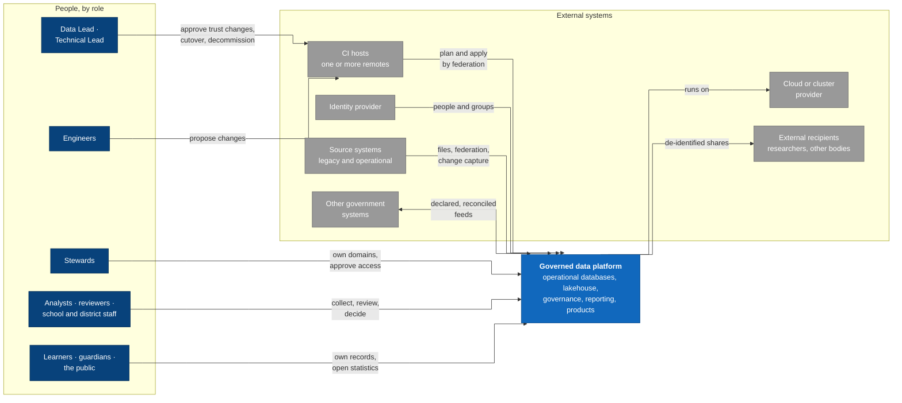
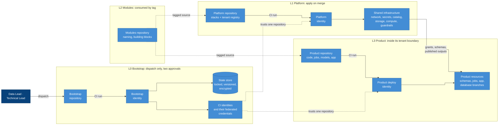
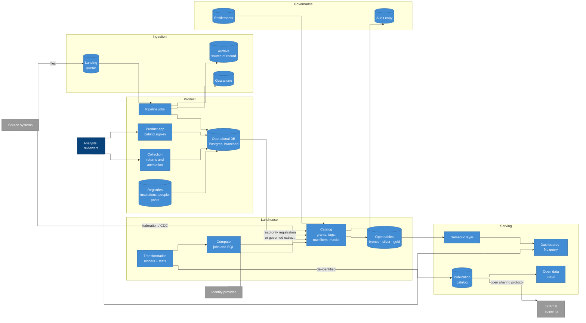
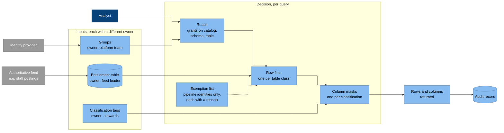
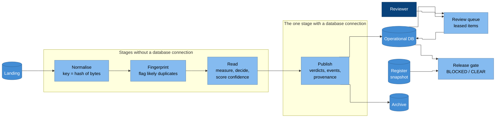

# Architecture

The architecture at three C4 levels: the system in its context (C1), the
containers inside it (C2), and the components of the containers where most
of the design lives (C3). Every box is a capability or a group of
capabilities from the [catalogue](../capabilities/README.md); no box names a
product, because products are an implementation's choice
([implementations](../implementations/README.md)).

Colours follow C4: people dark blue, the system and its containers blue,
external systems grey.

## C1 System context

### Why it is drawn this way

- **Changes reach the platform only through CI.** Engineers and leads act
  on the CI host, never on the platform directly
  ([P1](../principles.md#p1-ci-is-the-only-deployer)). The edge from people
  to the platform is for using it, not changing it.
- **CI hosts are plural.** A repository can live on more than one host; the
  architecture depends on federation, which every mainstream host offers,
  not on any one host ([CAP-REPOSITORIES.5](../capabilities/cap-repositories.md)).
- **Recipients are outside the boundary.** Data leaves only as
  de-identified publication ([P15](../principles.md#p15-publish-never-export)).
- **The identity provider is the organisation's,** not the platform's
  ([CAP-IDENTITY.1](../capabilities/cap-identity.md)). Learners, guardians
  and the public sign in separately and never join platform groups
  ([CAP-IDENTITY.6](../capabilities/cap-identity.md)).
- **Exchanges with other government systems run both ways** and are each
  declared and reconciled ([CAP-INTEROPERABILITY](../capabilities/cap-interoperability.md)).

## C2 Containers: trust and delivery

Each row is a layer and a repository. Every arrow from a repository to an
identity is a CI run that exchanges the CI host's per-run token for that
identity (federation); no arrow starts on a workstation.

### Why it is drawn this way

- **Rows are trust levels, and each row is a repository**
  ([P2](../principles.md#p2-repositories-are-split-by-trust-state-is-split-by-blast-radius)).
  A row's identity cannot act in another row, because its federated
  credential trusts one repository only.
- **The bootstrap row alone is dispatched by people.** It declares who CI
  is, so a merge alone must never change it
  ([P4](../principles.md#p4-the-root-of-trust-is-made-once-by-a-person-and-cannot-widen-itself)).
- **The platform reaches products only through what it generates from the
  tenant registry:** grants, schemas and published outputs. The product
  never reads platform state ([CAP-ONBOARDING.3](../capabilities/cap-onboarding.md)).
- **Modules and trust are dashed:** modules are source code and credentials
  are declarations, neither is a runtime call.

## C2 Containers: the data platform

### Why it is drawn this way

- **The catalog sits in the middle** because every read and write of
  analytical data goes through it, which is what makes one set of policies
  enough ([CAP-CATALOG](../capabilities/cap-catalog.md),
  [CAP-COMPUTE.3](../capabilities/cap-compute.md)).
- **Landing feeds the pipeline, and the pipeline feeds archive and
  quarantine:** landing is a queue, not a store
  ([CAP-INGESTION.2](../capabilities/cap-ingestion.md)).
- **The product app talks only to its operational database.** Analytics
  reach that database through the catalog, never by a direct connection
  ([CAP-OPERATIONALDB.7](../capabilities/cap-operationaldb.md)).
- **Dashboards read the semantic layer, not tables,** so a measure has one
  definition ([P11](../principles.md#p11-reporting-goes-through-a-governed-transformation-layer)).
- **Publication is a separate store fed only by models,** so nothing reaches
  a recipient without passing through de-identification
  ([CAP-SHARING.1](../capabilities/cap-sharing.md)). Open statistics leave
  through the portal after disclosure control
  ([CAP-PUBLICATION](../capabilities/cap-publication.md)).
- **Registries and collection sit with the products** because they are
  operational: they hold the authoritative records and returns that
  everything downstream counts ([CAP-MASTERDATA](../capabilities/cap-masterdata.md),
  [CAP-COLLECTION](../capabilities/cap-collection.md)).

## C3 Components: access decision

How the catalog decides what one query returns.

### Why it is drawn this way

- **Three inputs, three owners**
  ([P14](../principles.md#p14-access-is-role--scope--sensitivity)): the
  platform team owns groups, a loader owns entitlements, stewards own
  classification. No one change widens all three
  ([CAP-ACCESS.6](../capabilities/cap-access.md)).
- **The decision is a chain that only narrows.** Reach admits the table;
  the row filter and masks can only remove from it
  ([CAP-ACCESS.3](../capabilities/cap-access.md)).
- **The exemption list is dashed and short.** Every entry is a path to raw
  data ([CAP-ACCESS.4](../capabilities/cap-access.md)).

## C3 Components: product pipeline

The example product's processing, from file to released result. The
[document-review product](../product/document-review.md) describes it in full.

### Why it is drawn this way

- **Stages are separate jobs joined by storage,** so a stage cannot outrun
  the one before it, and each can be retried alone
  ([CAP-PIPELINE.3](../capabilities/cap-pipeline.md)).
- **Only publish touches the database.** The three stages before it keep
  working while the database is unavailable
  ([CAP-PIPELINE.6](../capabilities/cap-pipeline.md)).
- **Review sits beside the pipeline, not in it.** People decide at their own
  pace, and their decisions outrank any re-run
  ([CAP-REVIEW.3](../capabilities/cap-review.md)).
- **The gate reads both the database and the register snapshot,** because
  release needs the expected subjects as well as the results
  ([CAP-RELEASE.1](../capabilities/cap-release.md)).
