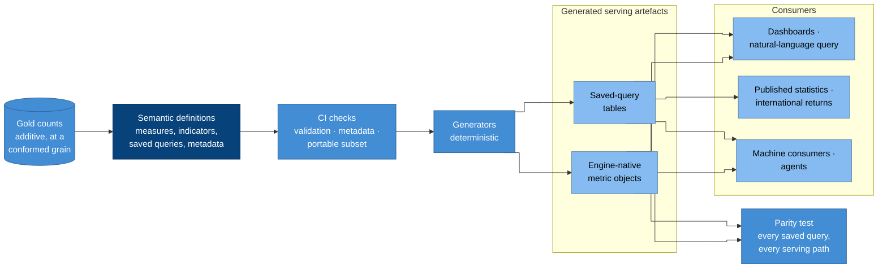

# The semantic layer

The semantic layer is where every measure and indicator is defined, once,
in version control. Dashboards, natural-language query, agents, published
statistics and international returns all read from it, so an enrolment
ratio means the same thing on every screen, in every file and for every
release ([P11](../principles.md#p11-reporting-goes-through-a-governed-transformation-layer),
[CAP-SEMANTICS](../capabilities/cap-semantics.md)).

It matters more for an EMIS than for most platforms. Official indicators
are compared across years, areas and countries; a definition that drifts
between two tools produces two "official" figures, and only one of them
can be right.

## How it works



### Why it is drawn this way

- **Definitions sit on top of gold counts.** Gold stores additive counts;
  every ratio is computed by the semantic layer from them, so any level of
  aggregation gives the right answer ([CAP-TRANSFORMATION.5](../capabilities/cap-transformation.md)).
- **Everything a consumer reads is generated.** Engine-native metric
  objects and saved-query tables are produced from the definitions by
  CI, never written by hand ([CAP-SEMANTICS.8](../capabilities/cap-semantics.md)).
- **A parity test closes the loop.** Every serving path must return the
  same numbers for every saved query, which is what "defined once" means in
  practice ([CAP-SEMANTICS.9](../capabilities/cap-semantics.md)).
- **Published statistics come from saved-query tables,** stamped with the
  definition version and reference date, never from a live query.

## Rules that keep one definition portable

1. **Model indicators as ratios of additive counts on one gold table.** An
   indicator's numerator and denominator are counts at the same grain
   (reference date, area, sex, age, level and so on). An external
   denominator, such as a population estimate, is joined in gold with its
   version, so every engine computes the ratio the same way.
2. **Use a portable subset of metric types:** simple counts and sums,
   ratios, and derived expressions without time offsets. Anything else
   (cumulative windows, offsets, conversion funnels) needs a recorded,
   tested mapping for each serving engine
   ([CAP-SEMANTICS.7](../capabilities/cap-semantics.md)).
3. **Keep indicator metadata with the definition** and check it in CI:
   code, the edition of the international definition followed, unit,
   reference-date rule, allowed disaggregations, coverage rule, owner and
   version ([CAP-SEMANTICS.3](../capabilities/cap-semantics.md)).
4. **Version the definitions with the models** that produce their counts,
   in the same project and the same review
   ([CAP-SEMANTICS.6](../capabilities/cap-semantics.md)).

## In the reference implementations

Both reference implementations use the **dbt semantic layer**
([ADR-0011](../adr/0011-dbt-semantic-layer.md)): semantic models and
metrics written in dbt's YAML specification (the latest spec, dbt 1.12 and
later), validated and compiled by **MetricFlow**, which is Apache-2.0
licensed.

| | Open source | Databricks |
| --- | --- | --- |
| Definitions | dbt semantic YAML in the transformation project | The same |
| Engine | MetricFlow over Trino, through dbt-trino | MetricFlow over Databricks SQL, through dbt-databricks |
| Engine-native objects | — | Unity Catalog metric views, generated as dbt models with the `metric_view` materialisation |
| Saved-query tables | dbt models generated from MetricFlow's compiled SQL | The same |
| Dashboards | Superset reads the saved-query tables; Superset's semantic-layer support is tracked | AI/BI dashboards and Genie read the metric views |
| Machine consumers | A thin service over MetricFlow and Trino | Genie and SQL over metric views |

dbt's hosted platform adds live semantic APIs, scheduled exports, caching
and ready-made BI integrations. Neither implementation depends on it:
known questions are served from generated tables, and ad-hoc questions go
through the engine-native objects or a MetricFlow-backed service. An open
format for exchanging semantic definitions,
[Apache Ossie](../standards.md#open-data-and-exchange), is tracked; once
dbt and the consuming engines support the same released version, the
generators can be replaced by it.

### An indicator, as defined

An illustrative definition of the gross enrolment ratio
([indicators](../domain/indicators.md#worked-example-gross-enrolment-ratio))
in dbt's latest YAML specification. Field names follow the dbt
documentation as of October 2026; check the current specification before
copying.

```yaml
models:
  - name: gold_enrolment_by_level
    description: >-
      Enrolled learners and official-age population, as at each census
      reference date, by area, sex and ISCED level.
    semantic_model:
      enabled: true
      agg_time_dimension: reference_date
    columns:
      - name: enrolment_level_key
        entity:
          type: primary
          name: enrolment_level
      - name: reference_date
        dimension:
          type: time
        granularity: day
      - name: area_code
        dimension:
          type: categorical
      - name: sex
        dimension:
          type: categorical
      - name: isced_level
        dimension:
          type: categorical
    metrics:
      - name: enrolled_learners
        type: simple
        agg: sum
        expr: enrolled_count
      - name: official_age_population
        type: simple
        agg: sum
        expr: official_age_population

metrics:
  - name: gross_enrolment_ratio
    label: Gross enrolment ratio
    description: >-
      Total enrolment in a level, regardless of age, as a share of the
      population of official school age for that level.
    type: ratio
    numerator: enrolled_learners
    denominator: official_age_population
    config:
      meta:
        indicator_code: GER
        definition: UIS Glossary, Education Metadata (2026)
        unit: ratio
        reference_date_rule: census reference date
        disaggregations: [area_code, sex, isced_level]
        denominator_source: population estimate, versioned in reference data
        owner: statistics steward
        version: 1
```
