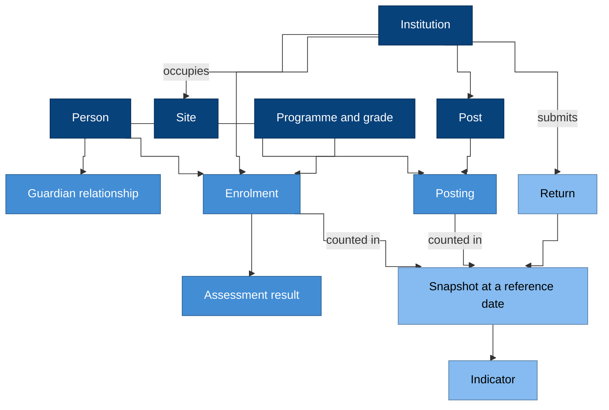

# The EMIS domain

Before anyone can build an EMIS, everyone involved has to mean the same
thing by the same words. This page explains what a domain model is, why
this blueprint uses one, and the main things an EMIS records.

## What a domain model is

The idea comes from Eric Evans's book *Domain-Driven Design* (2003). His
own summary, the [DDD Reference](https://domainlanguage.com/ddd/reference/)
(2015, Creative Commons Attribution 4.0), defines the two key words:

> **domain:** A sphere of knowledge, influence, or activity. The subject
> area to which the user applies a program is the domain of the software.
>
> **model:** A system of abstractions that describes selected aspects of
> a domain and can be used to solve problems related to that domain.

Here the domain is education administration, and the model is the set of
things an EMIS records and the rules between them: a learner is enrolled
at an institution, a teacher is posted to a post, a census counts
enrolments on a reference date.

Martin Fowler describes the approach as one that "centers the development
on programming a domain model that has a rich understanding of the
processes and rules of a domain", and notes it is "particularly suited to
complex domains, where a lot of often-messy logic needs to be organized"
([Domain Driven Design](https://martinfowler.com/bliki/DomainDrivenDesign.html), 2020).

## Why this blueprint uses one

- **The words are contested.** Planners, school staff, examination
  boards and statisticians all say "student", "class" or "programme", and
  often mean different things. A shared, written vocabulary removes the
  guesswork. Evans calls it the *ubiquitous language*: "a language
  structured around the domain model and used by all team members".
- **Figures depend on definitions.** An enrolment rate is only
  comparable year on year if "enrolled" means the same thing each year.
- **The data outlives the software.** Records about a learner matter for
  decades; the systems that hold them will be replaced several times.
  The model is what survives.
- **Many teams build it.** This blueprint is implemented on different
  technology by different people. The model is what keeps their results
  compatible.

One model for everything does not work for a system this size. Fowler
again: "total unification of the domain model for a large system will not
be feasible or cost-effective" ([Bounded Context](https://martinfowler.com/bliki/BoundedContext.html), 2014).
So the EMIS domain is split into **bounded contexts** (learning,
workforce, statistics and others), each with its own vocabulary. The
[context map](../../CONTEXT-MAP.md) lists them.

## The model at a glance

### Why it is drawn this way

- **Dark boxes are things that exist on their own:** a person, an
  institution, a site, a post, a programme.
- **Middle boxes are relationships with dates:** a person *is* a learner
  only through an enrolment, a teacher only through a posting, a guardian
  only through a guardian relationship. Each starts and ends.
- **Light boxes are statistics:** counted from the relationships, as at a
  reference date, and published as indicators.

## The main concepts

Each concept below is defined precisely in its context's vocabulary,
linked at the end of each section.

### Person

Every human the system knows about is recorded once, as a person, with
an identifier that never changes. Being a learner, a teacher or a
guardian is a *role* someone holds, not a separate record, so a teacher
who is also a parent is still one person.
[People context](../specifications/domain/contexts/people/CONTEXT.md).

### Institution and site

An institution is the organisation that provides education, such as a
school or college. A site is a physical place. They are separate because
one institution can use several sites, and one building can house
several institutions.
[Institutions context](../specifications/domain/contexts/institutions/CONTEXT.md).

### Learner and enrolment

An enrolment says that a person is registered at an institution, in a
programme and grade, for an academic period, from one date to another.
Being a learner is having an enrolment. A transfer ends one enrolment and
starts another; nothing is overwritten.
[Learning context](../specifications/domain/contexts/learning/CONTEXT.md).

### Guardian

A guardian is a person, or sometimes a body such as an agency, with legal
authority for a learner. The relationship has dates, and when the
authority ends, so does the guardian's access to the learner's records.
[Learning context](../specifications/domain/contexts/learning/CONTEXT.md).

### Staff, post and posting

A post is a position at an institution, such as a mathematics teacher
post. A posting puts a person in a post for a period, possibly part time.
Counting posts and postings separately shows vacancies as well as staff.
[Workforce context](../specifications/domain/contexts/workforce/CONTEXT.md).

### Programme, grade and class

A programme is a course of education, such as lower secondary; a grade is
a year within it. A class is a group taught together, which may mix
grades, so being in a class is recorded separately from being enrolled.
[Curriculum context](../specifications/domain/contexts/curriculum/CONTEXT.md).

### Assessment

Tests and examinations, who sat them, and their results. Once a result is
released it is never edited; a correction is a new version.
[Assessment context](../specifications/domain/contexts/assessment/CONTEXT.md).

### Collection, return and snapshot

A collection, such as the annual census, asks every institution for a
return about a fixed reference date. Returns are checked, attested and
accepted; the accepted figures are locked as a snapshot, which is what
gets published.
[Statistics context](../specifications/domain/contexts/statistics/CONTEXT.md).

### Indicator

An indicator is a defined calculation over the snapshot, such as the
gross enrolment ratio. It is defined once and used everywhere: on
dashboards, in publications and in international returns.
[Statistics context](../specifications/domain/contexts/statistics/CONTEXT.md).

### Reference data

Shared lists that give codes their meaning: types of institution, exit
reasons, administrative areas, academic periods. A code keeps its meaning
for ever; a new meaning gets a new code.
[Reference context](../specifications/domain/contexts/reference/CONTEXT.md).

## Where to go deeper

- The [domain specification](../specifications/domain/README.md): the
  resources, the modelling rules and the default sensitivity of each.
- The [domain design](../specifications/domain/design.md): the bounded
  contexts, the rules each record must always keep, and the events they
  publish.

Next: [data in an EMIS](data.md).
