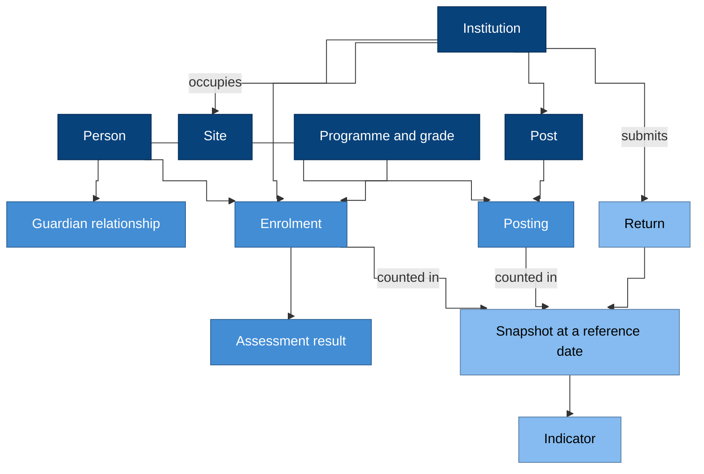

# The EMIS domain

Before anyone can build an EMIS, everyone involved has to mean the same
thing when they use the same word. This page explains what a domain model
is and why we use one, and then introduces the main things an EMIS
records.

## What a domain model is

The idea comes from Eric Evans's book *Domain-Driven Design* (2003). His
own summary, the [DDD Reference](https://domainlanguage.com/ddd/reference/)
(2015, Creative Commons Attribution 4.0), defines the two words that
matter most here:

> **domain:** A sphere of knowledge, influence, or activity. The subject
> area to which the user applies a program is the domain of the software.
>
> **model:** A system of abstractions that describes selected aspects of
> a domain and can be used to solve problems related to that domain.

In our case, the domain is education administration. The model is the set
of things an EMIS records and the rules that connect them. For example, a
learner is enrolled at an institution, a teacher is posted to a post, and
a census counts enrolments on a reference date.

Martin Fowler describes the approach as one that "centers the development
on programming a domain model that has a rich understanding of the
processes and rules of a domain", and notes it is "particularly suited to
complex domains, where a lot of often-messy logic needs to be organized"
([Domain Driven Design](https://martinfowler.com/bliki/DomainDrivenDesign.html), 2020).

## Why this blueprint uses one

There are four reasons, and each of them is about keeping people and
systems in agreement.

First, the words are contested. Planners, school staff, examination
boards and statisticians all say "student", "class" or "programme", and
they often mean different things by them. A shared vocabulary, written
down, removes the guesswork. Evans calls this the *ubiquitous language*:
"a language structured around the domain model and used by all team
members".

Second, figures depend on definitions. You can only compare an enrolment
rate from one year to the next if "enrolled" meant the same thing in both
years.

Third, the data outlives the software. Records about a learner matter for
decades, and the systems that hold them will be replaced several times in
that time. The model is the part that carries over from one system to
the next.

Fourth, many teams build the blueprint, on different technology. The
model is what keeps their results compatible with each other.

That doesn't mean one model for everything, though. For a system this
size, that doesn't work. As Fowler puts it, "total unification of the
domain model for a large system will not be feasible or cost-effective"
([Bounded Context](https://martinfowler.com/bliki/BoundedContext.html), 2014).
So we split the EMIS domain into **bounded contexts**, such as learning,
workforce and statistics, and each one has its own vocabulary. The
[context map](../../CONTEXT-MAP.md) lists them all.

## The model at a glance

### Why it is drawn this way

- The dark boxes are things that exist on their own, such as a person,
  an institution, a site, a post or a programme.
- The middle boxes are relationships, and each one has dates. A person
  *is* a learner only because they have an enrolment, a teacher only
  because they have a posting, and a guardian only because they have a
  guardian relationship. Each of these starts and ends.
- The light boxes are statistics. We count them from the relationships,
  as at a reference date, and publish them as indicators.

## The main concepts

Each concept below is defined precisely in the vocabulary of its context.
You'll find a link to that vocabulary at the end of each section.

### Person

The system records every human it knows about once, as a person, with an
identifier that never changes. Being a learner, a teacher or a guardian
is a *role* that someone holds, not a separate record. So a teacher who
is also a parent is still one person. See the
[People context](../specifications/domain/contexts/people/CONTEXT.md).

### Institution and site

An institution is the organisation that provides education, such as a
school or a college. A site is a physical place. We keep them separate
because one institution can use several sites, and one building can house
several institutions. See the
[Institutions context](../specifications/domain/contexts/institutions/CONTEXT.md).

### Learner and enrolment

An enrolment says that a person is registered at an institution, in a
programme and grade, for an academic period, from one date to another.
Being a learner simply means having an enrolment. When a learner
transfers, one enrolment ends and another starts, so nothing is
overwritten. See the
[Learning context](../specifications/domain/contexts/learning/CONTEXT.md).

### Guardian

A guardian is a person, or sometimes a body such as an agency, with legal
authority for a learner. The relationship has dates. When the authority
ends, the guardian's access to the learner's records ends with it. See
the [Learning context](../specifications/domain/contexts/learning/CONTEXT.md).

### Staff, post and posting

A post is a position at an institution, such as a post for a mathematics
teacher. A posting puts a person in a post for a period, possibly part
time. Because we count posts and postings separately, you can see
vacancies as well as staff. See the
[Workforce context](../specifications/domain/contexts/workforce/CONTEXT.md).

### Programme, grade and class

A programme is a course of education, such as lower secondary, and a
grade is a year within it. A class is a group of learners taught
together, and it may mix grades. That's why we record being in a class
separately from being enrolled. See the
[Curriculum context](../specifications/domain/contexts/curriculum/CONTEXT.md).

### Assessment

This covers tests and examinations, who sat them, and their results.
Once a result is released, nobody edits it. A correction becomes a new
version instead. See the
[Assessment context](../specifications/domain/contexts/assessment/CONTEXT.md).

### Collection, return and snapshot

A collection, such as the annual census, asks every institution for a
return about a fixed reference date. Each return is checked, attested and
accepted. The accepted figures are then locked in a snapshot, and the
snapshot is what gets published. See the
[Statistics context](../specifications/domain/contexts/statistics/CONTEXT.md).

### Indicator

An indicator is a defined calculation over the snapshot, such as the
gross enrolment ratio. We define each indicator once and use that
definition everywhere, on dashboards, in publications and in
international returns. See the
[Statistics context](../specifications/domain/contexts/statistics/CONTEXT.md).

### Reference data

Reference data is the shared lists that give codes their meaning, such as
types of institution, exit reasons, administrative areas and academic
periods. A code keeps its meaning for ever, and a new meaning gets a new
code. See the
[Reference context](../specifications/domain/contexts/reference/CONTEXT.md).

## Where to go deeper

- The [domain specification](../specifications/domain/README.md) gives
  the resources, the modelling rules, and the default sensitivity of each
  resource.
- The [domain design](../specifications/domain/design.md) describes the
  bounded contexts, the rules each record must always keep, and the
  events the contexts publish.

Next: [data in an EMIS](data.md).
