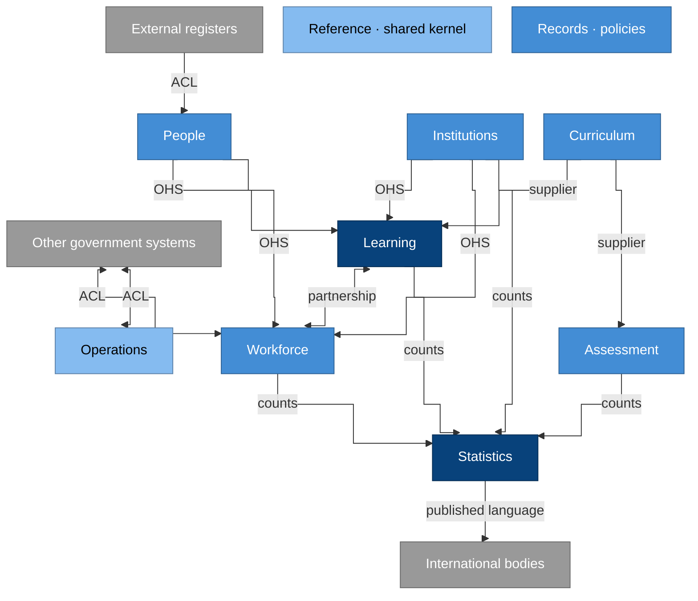

# Domain design

How the EMIS domain is designed, using domain-driven design: which parts
matter most, where the boundaries between models lie, what each model
guarantees, and how the parts talk. The language of each context is in
its `CONTEXT.md`, listed in the [context map](../../CONTEXT-MAP.md); the
resources and modelling rules are in the [domain model](README.md).

## Subdomains

| Kind | Contexts | Why |
| --- | --- | --- |
| Core | Learning, Statistics | What an education authority uses an EMIS for: knowing who is learning where, and producing official figures about it. Built and modelled with the most care. |
| Supporting | People, Institutions, Workforce, Curriculum, Assessment, Records | Needed by the core and specific to education, but each is a well-understood pattern (a registry, an establishment, a classification). |
| Generic | Operations, Reference | Finance, assets, entitlement schemes, safety, codes and calendars: often provided by existing systems or standards, integrated rather than invented. |

## Context map

### Why it is drawn this way

- **Core contexts are darkest.** Learning and Statistics carry the
  decisions the authority answers for; everything else serves them.
- **People and Institutions feed others as open host services:** they
  publish identifiers and a stable interface, so every context refers to
  the same person and institution without copying them.
- **External systems sit behind anti-corruption layers,** so a civil
  register's or a finance system's model never becomes the EMIS's model.
- **Statistics reads published counts only.** That keeps official figures
  independent of how each context stores its operational records
  ([CAP-INTEROPERABILITY.8](../capabilities/cap-interoperability.md)).
- **Reference and Records have no edges** because they shape every
  context (shared codes, shared retention policy); drawing all their edges
  would hide the rest. The [context map](../../CONTEXT-MAP.md) lists them.
- **ACL** is an anti-corruption layer; **OHS** an open host service;
  **counts** are the gold tables each context publishes.

## Aggregates and invariants

An aggregate is a cluster of records changed together as one unit, with a
root that every change goes through. The invariants below hold after
every change; a change that would break one is refused.

| Context | Aggregate (root) | Invariants |
| --- | --- | --- |
| People | Person | One person per human: a suspected duplicate goes to review, never auto-merged. The identifier never changes or is reused; a merge leaves a redirect from the retired identifier. External identifiers are attributes, each with an issuer and validity. |
| Institutions | Institution | An active institution occupies at least one site. Closing it ends every occupancy on the closure date. A merger is an effective-dated event on both institutions; neither history is lost. |
| Institutions | Site | Facility status is recorded as at a date; a new status supersedes, never overwrites, the previous one. |
| Learning | Enrolment | It refers to one person, institution, programme, grade and academic period. A learner has at most one main enrolment at any moment; others are secondary. An ended enrolment has an exit reason; an active one has none. |
| Learning | Guardian relationship | It refers to a learner and a guardian (a person or an organisation) with legal authority, from a start date to an end date. Access through it ends when the authority ends. |
| Learning | Attendance session | It belongs to an enrolment, and its date lies inside the enrolment's validity. |
| Learning | Progression decision | At most one per enrolment per academic period; a revision is a new version that keeps the previous one. |
| Workforce | Post | A post belongs to one institution. The shares of full time of the postings to it at any moment add up to at most one. |
| Workforce | Posting | It refers to a person and a post. A person's postings at any moment add up to at most their contracted share of full time. |
| Curriculum | Programme | It maps to exactly one level in the current education-level crosswalk. Its grades are ordered without gaps. |
| Assessment | Administration | Its instrument version is fixed. A released result is never edited; a correction is a new version. |
| Statistics | Instrument | Once committed it never changes; next period's collection is a new version. |
| Statistics | Return | It moves only through its declared states. Only an attested return can be accepted, and a locked return never changes. |
| Statistics | Snapshot | It is locked as at its reference date. A revision is a new snapshot version, with the reason, and both remain readable. |
| Records | Disclosure | It records who received what, why, on what basis and how; it is never deleted before its own retention ends. |
| Records | Correction request | It produces a new version of the corrected record, approved by the steward; the original value stays readable. |

Rules that span aggregates are kept eventually consistent through events,
not by changing two aggregates at once. A transfer, for example, ends one
enrolment and starts another: two changes linked by the event between
them.

## Domain events

Events are named in the past tense, in the context's language, and
published as CloudEvents ([CAP-INTEROPERABILITY.9](../capabilities/cap-interoperability.md)).
Other contexts react to them instead of reading each other's records.

| Context | Events |
| --- | --- |
| People | PersonRegistered, PersonVerified, PersonsMerged, PersonsUnmerged, PersonDeceasedRecorded |
| Institutions | InstitutionRegistered, InstitutionsMerged, InstitutionClosed, OccupancyStarted, OccupancyEnded, FacilityStatusRecorded |
| Learning | LearnerEnrolled, EnrolmentEnded, ClassMembershipChanged, AttendanceRecorded, ProgressionDecided, GuardianAuthorityStarted, GuardianAuthorityEnded |
| Workforce | PostEstablished, PostAbolished, PostingStarted, PostingEnded |
| Assessment | ResultRecorded, ResultsReleased |
| Statistics | InstrumentCommitted, ReturnSubmitted, ReturnAttested, ReturnQueried, ReturnAccepted, AreaCleared, SnapshotLocked, SnapshotRevised, DatasetPublished |
| Records | RecordArchived, RecordClassDisposed, DisclosureMade, CorrectionApplied |
| Reference | CodeListVersionPublished, BoundaryVersionPublished |

For example, when **EnrolmentEnded** carries the exit reason
"transferred", Statistics counts the learner at the receiving institution
from the next **LearnerEnrolled**, and Records starts the retention clock
of the ended enrolment.

## Contexts and catalogs

| Context | Catalogs it owns |
| --- | --- |
| Reference | `reference` |
| People | `people` |
| Institutions | `institutions` |
| Learning | `learners` |
| Workforce | `workforce` |
| Curriculum | `curriculum` |
| Assessment | `assessment` |
| Statistics | `statistics`, `publication` |
| Records | `records` |
| Operations | `finance`, `resources`, `entitlements`, `safety` |

## How contexts map onto the platform

- **One steward per context.** Each context owns the catalogs of its
  resources (below) and is stewarded by one role.
- **A product sits inside one context.** Its repository, operational
  database and tenant entry belong to that context. A product that needs
  another context's data uses that context's published interfaces.
- **Contexts integrate only through published interfaces:** registry
  interfaces, domain events, and gold tables with their semantic-layer
  definitions. No product reads another context's operational database
  ([CAP-INTEROPERABILITY.8](../capabilities/cap-interoperability.md)).
- **The language follows the boundary.** A term means what its context's
  `CONTEXT.md` says; where two contexts use one word differently, each
  defines it, and translation happens at the interface between them.
