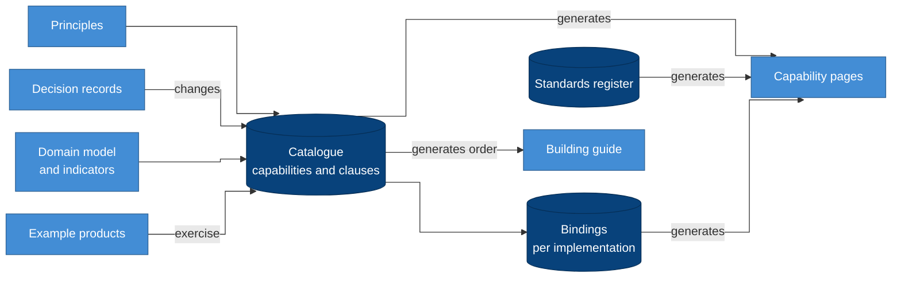

# Getting started

You don't need to read the whole blueprint, and we don't recommend it.
Read the first part, which explains what the blueprint is and why it
exists, and then the part that matches your role. Each step below tells
you what you'll know once you've read it, so you can stop as soon as you
have what you need.

## Everyone: the first hour

The documentation has three main sections, and they're meant to be read
in this order:

1. The **[core concepts](concepts/README.md)** explain what an EMIS is and
   the ideas the rest of the blueprint builds on. You don't need to know
   anything before you read them.
2. The **[specifications](specifications/README.md)** state what's
   required, precisely enough for you to build against them and test what
   you've built.
3. The **[guides](guides/README.md)** walk you through doing things, such
   as building an implementation, running a product or loading history.

Start here:

| # | Read | You will know |
| --- | --- | --- |
| 1 | [What is an EMIS](concepts/emis.md) | What the system is, who relies on it, and which part of it this blueprint covers |
| 2 | [The EMIS domain](concepts/domain.md) | What a domain model is, why we use one, and the main things an EMIS records |
| 3 | [Data in an EMIS](concepts/data.md) | The kinds of data an EMIS holds, and five ideas about handling them: sensitivity, masking, access by role and by attribute, sharing, and lineage |
| 4 | [Terminology](concepts/terminology.md) | The sensitivity tiers, layers, clauses, statuses and roles you'll meet everywhere |
| 5 | [Principles](specifications/principles.md) | The ideas every requirement rests on. If anything else seems to disagree with them, the principles say what was intended |

The [README](../README.md) gives you an overview on a single page. The
[glossary](specifications/glossary.md) and the
[context map](../CONTEXT-MAP.md) define every other term.

## Then follow your role

### Leads and decision-makers

You approve what gets built, and you answer for it.

1. The [decision records](adr/README.md) tell you what was decided and
   why, in the order the decisions were made.
2. The [implementations](specifications/implementations/README.md)
   describe the two reference stacks, and where open source differs from
   a managed platform.
3. The [standards](specifications/standards.md) list the international
   standards the blueprint relies on, with their current editions.
4. The [indicators](specifications/domain/indicators.md) page explains how
   official figures are defined and how they stay comparable.

### Architects and engineers building an implementation

You turn the blueprint into a platform that runs.

1. Start with the [capabilities](specifications/capabilities/README.md),
   which list every capability and its contract. Skim the index, then read
   the pages for the layer you're starting with.
2. [Building an implementation](guides/building.md) gives you the steps,
   in a build order generated from the dependencies.
3. The [semantic layer](specifications/architecture/semantic-layer.md)
   explains how each indicator is defined once and served to every
   consumer.
4. The [implementations](specifications/implementations/README.md) page
   and a reference binding
   ([open source](specifications/implementations/oss.yaml) or
   [Databricks](specifications/implementations/databricks.yaml)) show the
   components and the status of every clause.
5. The [standards](specifications/standards.md) give the editions each
   clause names.
6. The [lessons](guides/lessons.md) describe failures that shaped the
   design, so that you don't repeat them.

### Product teams

You build a workload on the platform.

1. Read the [domain model](specifications/domain/README.md), the
   [indicators](specifications/domain/indicators.md) and the
   [semantic layer](specifications/architecture/semantic-layer.md).
2. Read the [example products](guides/products/README.md), document
   review and the annual census, as worked examples.
3. The [product checklist](guides/products/checklist.md) tells you what
   your product needs to record about each capability it relies on.
4. Read the [backfill patterns](guides/backfill.md) before you load any
   history.

### Data stewards and governance

You decide who may see what, and what leaves the platform.

1. Read principles
   [P12](specifications/principles.md#p12-provenance-before-any-drop),
   [P14](specifications/principles.md#p14-access-is-role--scope--sensitivity),
   [P15](specifications/principles.md#p15-publish-never-export) and
   [P20](specifications/principles.md#p20-collect-for-a-declared-purpose).
2. [CAP-ACCESS](specifications/capabilities/cap-access.md),
   [CAP-CLASSIFICATION](specifications/capabilities/cap-classification.md)
   and [CAP-RECORDS](specifications/capabilities/cap-records.md) cover who
   sees which rows and columns, and how long records are kept.
3. [CAP-PUBLICATION](specifications/capabilities/cap-publication.md) and
   [CAP-SHARING](specifications/capabilities/cap-sharing.md) cover open
   statistics, sharing with partners, and the controls on both.
4. [CAP-QUALITY](specifications/capabilities/cap-quality.md) and
   [CAP-REFERENCE](specifications/capabilities/cap-reference.md) cover
   checks, corrections, code lists and the data dictionary.

### Contributors

You want to change the blueprint.

1. [Contributing](../CONTRIBUTING.md) tells you which path your change
   takes, how to set up, and what reviewers look for.
2. [LIP-1](lips/lip-0001.md) explains how a change is proposed, reviewed
   and decided.
3. The [decision records](adr/README.md) show what has been decided so
   far, so that your proposal can build on it instead of repeating it.
4. The [capabilities](specifications/capabilities/README.md) and the
   [domain language](../CONTEXT-MAP.md) are the text a proposal changes,
   and the words it should use.
5. When you're ready, start from the [LIP template](lips/template.md).

### Agents

Start with [AGENTS.md](../AGENTS.md). Then read
[`blueprint/catalogue.yaml`](../blueprint/catalogue.yaml) for the clauses
and [building.md](guides/building.md) for the order of work. Everything
the blueprint claims is either a clause, with a way to verify it, or a
principle, with its reason. Treat anything else as commentary.

## How the documents relate

### Why it is drawn this way

- The catalogue sits at the centre. We write each clause there once, and
  generate the capability pages, the build order and the implementation
  tables from it, so they can't drift apart.
- The principles and decision records sit upstream of it. A clause exists
  because a principle requires it, and it changes only through a decision
  record.
- The bindings and the standards register feed the capability pages, so
  each capability shows what implements it and which standards it names.
