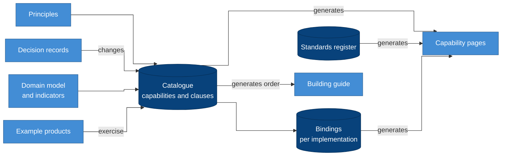

# Getting started

The blueprint is meant to be read in layers: first what it is and why,
then the part that matches your role. Each step says what you will know
after reading it, so you can stop as soon as you have what you need.

## Everyone: the first hour

Read these four in order.

| # | Read | You will know |
| --- | --- | --- |
| 1 | [README](../README.md) | What the blueprint is, how it is organised, and what it is not |
| 2 | [Principles](principles.md) | The ideas every decision rests on; when anything else seems to disagree, these state the intent |
| 3 | [Architecture](architecture/README.md) | How the parts fit together, at three levels of detail |
| 4 | [Domain model](domain/README.md) | What an EMIS holds: domains, resources and the rules for modelling them |

Keep the [domain language](../CONTEXT-MAP.md) and the [glossary](glossary.md)
open beside you. Domain terms such as *learner*, *enrolment*, *post* and
*reference date*, and blueprint terms such as *capability*, *clause*,
*binding* and *steward*, have precise meanings here.

## Then follow your role

### Leads and decision-makers

You approve what is built and answer for it.

1. [Decision records](adr/README.md): what was decided, and why, in the
   order it was decided.
2. [Implementations](implementations/README.md): the two reference stacks
   and where open source differs from a managed platform.
3. [Standards](standards.md): the international standards the blueprint
   relies on, with their current editions.
4. [Indicators](domain/indicators.md): how official figures are defined
   and kept comparable.

### Architects and engineers building an implementation

You turn the blueprint into a running platform.

1. [Capabilities](capabilities/README.md): every capability and its
   contract. Skim the index, then read the pages for the layer you start
   with.
2. [Building an implementation](building.md): the steps, with a build
   order generated from the dependencies.
3. [Semantic layer](architecture/semantic-layer.md): how every indicator is
   defined once and served to every consumer.
4. [Implementations](implementations/README.md) and a reference binding
   ([open source](implementations/oss.yaml) or
   [Databricks](implementations/databricks.yaml)): the components and the
   status of every clause.
5. [Standards](standards.md): the editions each clause names.
6. [Lessons](patterns/lessons.md): failures that shaped the design, so you
   do not repeat them.

### Product teams

You build a workload on the platform.

1. [Domain model](domain/README.md), [indicators](domain/indicators.md)
   and the [semantic layer](architecture/semantic-layer.md).
2. [Example products](product/README.md): document review and the annual
   census, read as worked examples.
3. [Product checklist](product/checklist.md): what your product records
   about each capability it relies on.
4. [Backfill patterns](patterns/backfill.md): before you load any history.

### Data stewards and governance

You decide who may see what, and what leaves the platform.

1. Principles [P12](principles.md#p12-provenance-before-any-drop),
   [P14](principles.md#p14-access-is-role--scope--sensitivity),
   [P15](principles.md#p15-publish-never-export) and
   [P20](principles.md#p20-collect-for-a-declared-purpose).
2. [CAP-ACCESS](capabilities/cap-access.md),
   [CAP-CLASSIFICATION](capabilities/cap-classification.md) and
   [CAP-RECORDS](capabilities/cap-records.md): who sees which rows and
   columns, and how long records are kept.
3. [CAP-PUBLICATION](capabilities/cap-publication.md) and
   [CAP-SHARING](capabilities/cap-sharing.md): open statistics, partner
   sharing, and their controls.
4. [CAP-QUALITY](capabilities/cap-quality.md) and
   [CAP-REFERENCE](capabilities/cap-reference.md): checks, corrections,
   code lists and the data dictionary.

### Contributors

You want to change the blueprint.

1. [LIP-1](lips/lip-0001.md): how a change is proposed, reviewed and
   decided.
2. [Decision records](adr/README.md): what has been decided so far, so a
   proposal builds on it rather than repeating it.
3. [Capabilities](capabilities/README.md) and the
   [domain language](../CONTEXT-MAP.md): the text a proposal changes, and the
   words it uses.
4. The [LIP template](lips/template.md).

### Agents

Start with [AGENTS.md](../AGENTS.md), then
[`blueprint/catalogue.yaml`](../blueprint/catalogue.yaml) for the clauses
and [building.md](building.md) for the order of work. Every claim the
blueprint makes is either a clause with a verification or a principle with
its reason; treat anything else as commentary.

## How the documents relate

### Why it is drawn this way

- **The catalogue is the centre.** Clauses are written once there; the
  capability pages, the build order and the implementation tables are
  generated from it, so they cannot drift apart.
- **Principles and decision records sit upstream.** A clause exists
  because a principle requires it, and it changes only through a decision
  record.
- **Bindings and the standards register feed the pages** so each
  capability shows what implements it and which standards it names.
