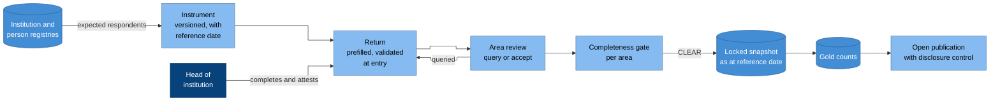

# Example product: annual census

Once a year, every institution reports a set of counts and facts as at a
single reference date. That includes enrolment by grade and sex, staff and
their qualifications, and facilities and services. The census is the
backbone of an education system's official statistics. As a product, it
exercises the registries, periodic collection, data quality, indicators,
disclosure control and open publication.

## Flow

### Why it is drawn this way

- **The registry decides who must respond.** Completeness is measured
  against the institutions that exist, not against the returns that
  happened to arrive
  ([CAP-COLLECTION.1](../../specifications/capabilities/cap-collection.md)).
- **The head of the institution attests the return.** That puts
  accountability for the figures with the person who knows them.
- **Review can send a return back.** A query reopens the return with the
  reviewer's reason, and every change of state is recorded as an event
  ([CAP-COLLECTION.3](../../specifications/capabilities/cap-collection.md)).
- **Nothing is computed until the area is complete,** and even then only
  from a locked snapshot
  ([CAP-COLLECTION.4](../../specifications/capabilities/cap-collection.md),
  [CAP-COLLECTION.5](../../specifications/capabilities/cap-collection.md)).

## The instrument

An **instrument** is a versioned file that declares these things:

- the reference date and the collection window
- the expected respondents, as a query over the institution registry
- each item, with its code list, its unit and whether it's required
- the validation rules, each with its quality dimension and severity
  ([CAP-QUALITY.4](../../specifications/capabilities/cap-quality.md))
- cross-item checks, such as comparing staff counts with the postings in
  the registry, or enrolment with last year's enrolment in the grade below

A blocking rule stops the return from being submitted, while a warning
only needs a reason. Once an instrument is committed it never changes, so
next year's census uses a new version.

## The return

A return arrives **prefilled** from the registries and last year's
accepted return, so respondents confirm and correct figures rather than
typing them again. It also **works offline**: someone can complete the
form without a connection and synchronise it later, and if they submit
twice, the two submissions end up as one return.

A return moves through these states: not started, in progress, submitted,
attested, queried, accepted and locked.

If a return is missing and the methodology allows **imputation**, every
imputed cell is flagged, and the flag is reported with the figure.

## Outputs

The census produces:

- gold counts as at the reference date, from which the semantic layer
  derives the participation, teacher and facilities indicators
  ([indicators](../../specifications/domain/indicators.md))
- completeness and timeliness for each institution and area, reported as
  measures
- open tables with permanent identifiers, after disclosure control
  ([CAP-PUBLICATION](../../specifications/capabilities/cap-publication.md))

When a late correction arrives, the revision is a new snapshot version.
It records the reason, and both versions stay readable.

## Running it as a conformance workload

Run these steps on your implementation, and check that each gives the
result described.

1. Open a census for a fixture registry. The expected respondents should
   be exactly the registry's active institutions as at the reference date.
2. Submit a return with a blocking error. The submission should be
   refused with a machine-readable error
   ([CAP-COLLECTION.2](../../specifications/capabilities/cap-collection.md)).
3. Submit the same return twice from an offline client. You should end up
   with one return.
4. Leave one institution's return missing. Its area should read BLOCKED,
   while the other areas release
   ([CAP-COLLECTION.4](../../specifications/capabilities/cap-collection.md)).
5. Publish an area that has a small cell. The cell and its complement
   should be suppressed, and you shouldn't be able to recompute the
   suppressed value from the totals
   ([CAP-PUBLICATION.2](../../specifications/capabilities/cap-publication.md)).
6. Correct an accepted return. A new snapshot version should be created,
   the published table should gain a new version, and the old version
   should still be retrievable
   ([CAP-PUBLICATION.3](../../specifications/capabilities/cap-publication.md)).
