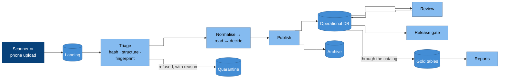

# Example product: document review

Document review is a small but complete workload that exercises every
layer of the platform. Scanned documents arrive and a machine processes
them. Any result the machine is unsure about goes to a person, and results
are only released once they reconcile against an external register. It's
the pattern behind the product capabilities
([CAP-PIPELINE](../../specifications/capabilities/cap-pipeline.md),
[CAP-REVIEW](../../specifications/capabilities/cap-review.md) and
[CAP-RELEASE](../../specifications/capabilities/cap-release.md)), and it's
the reference workload that every implementation should run from end to
end.

The same pattern fits any product where a document comes in, a machine
gives a verdict, people review it, the result is released under
governance, and then it's reported. Graded answer sheets, inspection
forms, claims and survey returns all work this way. We use graded answer
sheets as the running example below, but nothing depends on that choice.

## Domain

- **The exam is the aggregate.** It owns versioned sheet templates, and
  once a template version is committed it can't change. It also owns the
  grading policies, a rubric and a pinned snapshot of the register. Each
  sitting of an exam is a fork with its own identifier.
- **Structure is declared, not discovered.** It's written as versioned
  manifests, which give a kind, a name and labels but no surrogate IDs.
  When you apply a manifest, the product validates it and compares it by
  content hash with what's already there, so applying an identical spec
  does nothing. Otherwise it creates the next append-only version, records
  an event, and you activate that version explicitly.
- **The register is external.** The list of expected subjects, the
  enrolled students, belongs to another system. The product reads it
  through an adapter and freezes it as a snapshot for each sitting.
  Corrections are recorded as operations with events, never as edits in
  place.

## Flow

### Why it is drawn this way

- **Triage runs the cheapest checks first.** The content hash is checked
  at the door. Then a structural check refuses documents that don't
  belong, and a perceptual fingerprint flags likely rescans. Anything
  refused goes to quarantine with a reason; nothing quietly disappears.
- **Review loops back into the same database.** A human decision is just
  another write, but it's guarded so that no machine write can overwrite
  it.
- **Reports read gold through the catalog,** and never read the
  operational database directly
  ([CAP-TRANSFORMATION.3](../../specifications/capabilities/cap-transformation.md)).

## Stages

| Stage | Does | Reads → writes | Database |
| --- | --- | --- | --- |
| Normalise | Rectifies the page to match its template, and sends it to a person if the residual is high. It writes the normalised page and then, last of all, a small manifest that triggers the next stage. | landing → pages | no |
| Fingerprint | Hashes the marks on the page to flag likely rescans. It only flags them: a person confirms, and nothing is dropped automatically. | pages → fingerprints | no |
| Read | Measures each answer area and decides a label with a confidence, using measurements only. Anything below the threshold, or with a double mark, goes to review with a reason code. | pages → readings | no |
| Publish | Writes the verdicts, the events and a provenance record for each page, renders the review images, and moves the originals to the archive. | readings → database, archive | yes, and it's the only one |

Every artefact is stamped with `{stage, at, run_id}`. Publish puts
together one provenance record for each page, naming the version of every
stage. If a stage didn't run, the record shows it as absent rather than
inventing a value.

## What makes it retryable

- **A document's identity is the hash of its bytes.** So if the same file
  arrives under another name, or arrives twice, it still ends up as one
  record.
- **The pending work is worked out again from what exists.** Reading an
  item doesn't consume it, so a failed run leaves nothing stranded, and
  the next run sees the same work.
- **Overlapping runs waste effort, but they don't cause errors.** Safety
  comes from idempotence and atomic writes (write then rename, or copy
  then unlink), not from locks. The exception is a stage that holds an
  index in memory: it runs one at a time, because two copies of the index
  would each miss the other's matches.
- **Each run plans, fans out and finishes.** A planner cuts the work into
  slices that don't overlap, and workers process them. A finishing step
  re-queues the job only if work remains and the run made progress, and a
  run with nothing to do exits in seconds.
- **Runs are bounded.** Each run takes at most
  `floor(timeout / (1.5 × median item time))` items, with the median
  measured over recent runs. If the limit is missing or broken, the run is
  uncapped; it's never stopped.

## Review

- **There's one review item for each document.** It shows the identity,
  the flagged answers and any evidence of duplicates together, and the
  reviewer can only confirm once every part is complete.
- **People enter the identity.** When the machine read handwriting below a
  useful confidence, its reading was worse than none at all. So reviewers
  transcribe it, and the system works out which reading applies.
- **A lease is a primary key.** Claiming an item is a single statement,
  which either inserts a lease or takes over an expired one. Committing
  needs a live lease, checked before the first write, and whether a lease
  has expired is judged when it's read.
- **Duplicates are handled as sets.** The links between suspected
  duplicates are stored, and each connected group is decided together.
  Keeping, promoting and reverting are audited and reversible. A ruling
  that something is not a duplicate is stored where the detector can't
  overwrite it.
- **Every action applies immediately, and a compensating action reverses
  it.** Both records are kept.

## Release

For each institution and exam, the enrolled learners have to balance
against the confirmed documents. A duplicate, an orphan, a missing
student, a pending identity or a missing register each makes the gate
read **BLOCKED**, and results are only released when it reads **CLEAR**.
Once a group is released, every change after that is a new version.

## Reporting

All the arithmetic lives in transformation models. The application only
selects and formats the results, and a test stops its reporting code from
opening a database connection. Gold stores counts, not percentages. The
pipeline's telemetry, meaning its item metrics, limits and cost, reaches
gold too, so you can tell a rise in cost from a rise in the amount of
work.

## Environments

The product runs in production and in development branches of production
([CAP-ENVIRONMENTS](../../specifications/capabilities/cap-environments.md)).
A development branch has its own database and its own storage. It can
read production's documents, but only through a read-only path, and any
upload there is refused. Every deployment reports, on its health
endpoint, which environment it believes it's in.

## Running it as a conformance workload

Your implementation proves the product capabilities by running a fixture
corpus through the product. Run these steps, and check that each gives the
result described.

1. Submit the corpus, then submit it again under different names. You
   should get one record for each document
   ([CAP-PIPELINE.1](../../specifications/capabilities/cap-pipeline.md)).
2. Process it twice. The outputs should be byte-identical
   ([CAP-PIPELINE.2](../../specifications/capabilities/cap-pipeline.md)).
3. Make the database unreachable. The three upstream stages should still
   complete
   ([CAP-PIPELINE.6](../../specifications/capabilities/cap-pipeline.md)).
4. Have several reviewers race for the same item. Exactly one of them
   should hold the lease
   ([CAP-REVIEW.2](../../specifications/capabilities/cap-review.md)).
5. Re-run the pipeline over items that have been reviewed. No human
   decision should change
   ([CAP-REVIEW.3](../../specifications/capabilities/cap-review.md)).
6. Load each blocking fixture. The gate should read BLOCKED, and should
   read CLEAR only for the balanced one
   ([CAP-RELEASE.1](../../specifications/capabilities/cap-release.md)).
