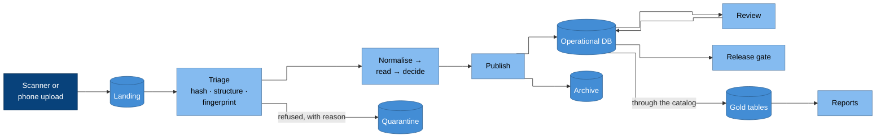

# Example product: document review

A small, complete workload that exercises every layer of the platform:
scanned documents arrive, are processed by machine, uncertain results go to
people, and results are released only when they reconcile against an
external register. It is the pattern behind the product capabilities
([CAP-PIPELINE](../../specifications/capabilities/cap-pipeline.md),
[CAP-REVIEW](../../specifications/capabilities/cap-review.md),
[CAP-RELEASE](../../specifications/capabilities/cap-release.md)) and the reference workload
every implementation should run end to end.

The pattern fits any **document in → machine verdict → human review →
governed release → reporting** product: graded answer sheets, inspection
forms, claims, survey returns. The text below uses graded answer sheets as
its running example; nothing in it depends on that.

## Domain

- **Exam.** The aggregate. It owns versioned sheet templates (a committed
  version is immutable), grading policies, a rubric and a pinned register
  snapshot. A sitting of an exam is a fork with its own identifier.
- **Declared, not discovered.** Structure is declared as versioned
  manifests (kind, name, labels; no surrogate IDs). Applying a manifest
  validates it, diffs it by content hash (an identical spec is a no-op),
  mints the next append-only version with an event, and activates it
  explicitly.
- **The register is external.** The list of expected subjects (enrolled
  students) belongs to another system, read through an adapter and frozen
  as a snapshot per sitting. Corrections are evented operations, never
  edits in place.

## Flow

### Why it is drawn this way

- **Triage runs cheapest first:** content hash at the door, then a
  structural check that refuses foreign documents, then a perceptual
  fingerprint that flags likely rescans. Refusals go to quarantine with a
  reason, never silently away.
- **Review loops back into the same database,** because a human decision is
  just another write, guarded so no machine write can overwrite it.
- **Reports read gold through the catalog,** never the operational database
  directly ([CAP-TRANSFORMATION.3](../../specifications/capabilities/cap-transformation.md)).

## Stages

| Stage | Does | Reads → writes | Database |
| --- | --- | --- | --- |
| Normalise | Rectifies the page to its template; a high residual goes to a person. Writes the normalised page and, last, a small manifest that triggers the next stage. | landing → pages | no |
| Fingerprint | Hashes the marks on the page to flag likely rescans. It only flags; a person confirms; nothing is dropped automatically. | pages → fingerprints | no |
| Read | Measures each answer area and decides a label with a confidence, from measurements only. Below threshold, or any double mark, goes to review with a reason code. | pages → readings | no |
| Publish | Writes verdicts, events and a provenance record per page; renders review images; sweeps originals to the archive. | readings → database, archive | yes, the only one |

Every artefact is stamped with `{stage, at, run_id}`. Publish assembles one
provenance record per page that names the version of every stage; a stage
that did not run reads as absent, never invented.

## What makes it retryable

- **Identity is the hash of the bytes.** The same file under another name,
  or delivered twice, converges on one record.
- **Pending is recomputed from what exists.** Nothing is consumed on read,
  so a failed run strands nothing; the next run sees the same work.
- **Overlap is wasteful, not wrong.** Safety comes from idempotence and
  atomic writes (write then rename, copy then unlink), not from locks.
  A stage that holds an index in memory runs at concurrency one, because
  two indexes would each miss the other's matches.
- **Plan, fan out, finish.** A planner cuts disjoint slices; workers
  process them; a finishing step re-queues the job only if work remains
  and the run made progress. A run with nothing to do exits in seconds.
- **Bounded runs.** Each run takes at most
  `floor(timeout / (1.5 × median item time))` items, the median measured
  over recent runs. A missing or broken limit means uncapped, never
  stopped.

## Review

- **One review item per document,** showing identity, flagged answers and
  duplicate evidence together. Confirm is enabled only when every part is
  complete.
- **Identity is entered by people.** Machine reads of handwriting below a
  useful confidence were worse than none, so reviewers transcribe and the
  system infers which reading applies.
- **A lease is a primary key.** Claim is one statement (insert, or take
  over an expired lease); commit requires a live lease checked before the
  first write; expiry is judged at read time.
- **Duplicates are sets.** Suspicion edges are stored and their connected
  components are decided together. Keep, promote and revert are audited,
  reversible transitions; a "not a duplicate" ruling is stored where the
  detector cannot overwrite it.
- **Every action applies immediately and is reversed by a compensating
  action.** Both records stay.

## Release

For each institution and exam, enrolled learners must balance against
confirmed documents. A duplicate, an orphan, a missing student, a pending
identity or an absent register each reads **BLOCKED**; results release only
on **CLEAR**. A released group is the point after which every change is a
new version.

## Reporting

All arithmetic lives in transformation models. The application selects and
formats; a test forbids its reporting code from opening a database
connection. Gold stores counts, not percentages. Pipeline telemetry (item
metrics, limits, cost) reaches gold too, so a rise in cost can be told
apart from a rise in work.

## Environments

The product runs in production and in development branches of it
([CAP-ENVIRONMENTS](../../specifications/capabilities/cap-environments.md)). A development
branch has its own database and its own storage; it may read production's
documents only through a read-only path, and uploads there are refused.
Every deployment reports on its health endpoint which environment it
believes it is in.

## Running it as a conformance workload

An implementation proves the product capabilities by running a fixture
corpus through the product:

1. Submit the corpus; submit it again under different names. One record
   per document results ([CAP-PIPELINE.1](../../specifications/capabilities/cap-pipeline.md)).
2. Process it twice; outputs are byte-identical
   ([CAP-PIPELINE.2](../../specifications/capabilities/cap-pipeline.md)).
3. Make the database unreachable; the three upstream stages complete
   ([CAP-PIPELINE.6](../../specifications/capabilities/cap-pipeline.md)).
4. Race concurrent reviewers for one item; exactly one holds the lease
   ([CAP-REVIEW.2](../../specifications/capabilities/cap-review.md)).
5. Re-run the pipeline over reviewed items; no human decision changes
   ([CAP-REVIEW.3](../../specifications/capabilities/cap-review.md)).
6. Load each blocking fixture; the gate reads BLOCKED, and CLEAR only for
   the balanced one ([CAP-RELEASE.1](../../specifications/capabilities/cap-release.md)).
