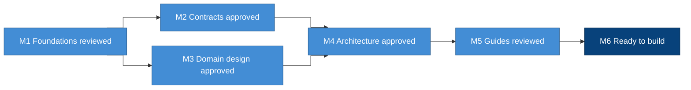

# Reviewing the blueprint

Most of the blueprint was drafted quickly, and the maintainers accepted it
directly, as [LIP-1](../lips/lip-0001.md) allows before 1.0.0. Before
anyone builds on it, every part needs a careful reading and a recorded
verdict. This guide tells you how that review is organised, what each
milestone settles, and how to give a verdict.

## Milestones

The review is tracked in the repository's
[milestones](https://github.com/LumenOSS/blueprint/milestones). Each one
has a due date, which is a target. We move it when the work needs more
time, and we say so here when we do.

The foundations come first because everything else is read against them.
The contracts and the domain design can be reviewed side by side. The
architecture waits for both, because its diagrams draw the capabilities
and the contexts. The guides come last, because they tell you how to
apply everything above them.

| Milestone | Due | It closes when |
| --- | --- | --- |
| M1 Foundations reviewed | 2026-10-30 | The core concepts, the principles, the standards register, the entry pages and the process records have a verdict |
| M2 Contracts approved | 2026-11-06 | Every clause of every capability is approved, changed or dropped |
| M3 Domain design approved | 2026-11-13 | The domain model, the context map, every context, the aggregates and events, the indicators and the glossary are agreed |
| M4 Architecture approved | 2026-11-20 | The C4 diagrams, the semantic layer, both reference bindings and the architecture records are agreed |
| M5 Guides reviewed | 2026-11-27 | Every guide matches the approved specifications, and the translations are brought back up to date |
| M6 Ready to build | 2026-12-04 | The buildout is planned in phases, the implementation repositories are laid out, and the 1.0.0 promise is written |

## What each milestone covers

| Milestone | What is reviewed |
| --- | --- |
| M1 Foundations reviewed | The [core concepts](../concepts/README.md), the [principles](../specifications/principles.md), the [standards](../specifications/standards.md), the [README](../../README.md), [getting started](../getting-started.md) and [contributing](../../CONTRIBUTING.md), and the records for the process itself: [ADR-0001](../adr/0001-record-architecture-decisions.md), [ADR-0012](../adr/0012-improvement-proposals.md) and [LIP-1](../lips/lip-0001.md) |
| M2 Contracts approved | The [capabilities](../specifications/capabilities/README.md), one issue for each of the five domains, with a checklist of its capabilities |
| M3 Domain design approved | The [domain model](../specifications/domain/README.md), the [context map](../../CONTEXT-MAP.md) and each context's `CONTEXT.md`, the [domain design](../specifications/domain/design.md), the [indicators](../specifications/domain/indicators.md), the [glossary](../specifications/glossary.md), and ADR-0008, ADR-0010 and ADR-0013 |
| M4 Architecture approved | The [architecture](../specifications/architecture/README.md) diagrams, the [semantic layer](../specifications/architecture/semantic-layer.md), the [implementations](../specifications/implementations/README.md), and ADR-0002 to ADR-0007, ADR-0009, ADR-0011 and ADR-0014 |
| M5 Guides reviewed | [Building](building.md), the [example products](products/README.md), [backfill](backfill.md), [lessons](lessons.md) and [translating](translating.md), and the French, Spanish and Arabic translations |
| M6 Ready to build | The buildout phases, the layout of the implementation repositories, how conformance evidence is shown, and what 1.0.0 promises |

## Give a verdict

Each area under review has an issue in its milestone, with a checklist of
the things to read. Anyone can comment with evidence or a view. The Data
Lead and the Technical Lead give the verdict.

1. Open the issue and read each item on its checklist.
2. Comment with a verdict for each item you have a view on.
   - For a page, a principle or a clause, the verdict is **approve**,
     **change** (give the new wording) or **drop** (give the reason).
   - For a decision record, the verdict is **confirm** or **supersede**
     (say what should replace it). Records are never edited, so a
     superseded decision gets a new record.
3. Make the change the verdict asks for, on the path
   [CONTRIBUTING](../../CONTRIBUTING.md) gives it. A change of wording
   that keeps the meaning is an ordinary reviewed change. A changed or
   dropped clause, a new domain term, or a superseded decision needs a
   LIP, which the maintainers may accept straight from Draft until 1.0.0.
4. Tick the item once its change has landed, and close the issue when
   every item is ticked.

If the review turns up something no issue covers, open a new issue in the
milestone it affects.
