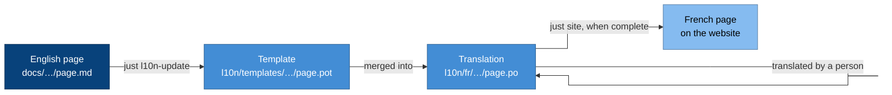

# Translating

The documentation is written in English and translated through translation
files, never by copying pages. This guide is for translators, and for
anyone who edits a page that has translations.

## How it works

- Each English page is split into strings (paragraphs, headings, list
  items, table cells) in a **template**, a standard gettext
  [PO file](https://www.gnu.org/software/gettext/manual/html_node/PO-Files.html).
- Each language has a **PO file** per page holding the translation of
  every string.
- When an English string changes, its translation is marked **fuzzy**: it
  needs checking. A page is published in a language only when every
  string is translated and none is fuzzy. Until then, readers see the
  English page, so they never read a translation that has fallen behind.
- Code blocks, diagrams and page headers are never offered for
  translation, so a translation cannot break them. Links become numbered
  placeholders such as `{1}`, which a translation keeps.
- Decision records and improvement proposals stay in English, the
  language they were decided in.

The languages are listed in [`l10n/languages.toml`](../../l10n/languages.toml).
`just l10n-status` shows how much of each is translated.

## Translate a page

1. Open the page's PO file, for example
   `l10n/fr/docs/concepts/emis.po`, in a PO editor such as
   [Poedit](https://poedit.net/) or [Lokalize](https://apps.kde.org/lokalize/),
   or in a translation platform that reads PO files, such as
   [Weblate](https://weblate.org/).
2. Translate every string. Keep each placeholder (`{1}`), each pair of
   `**` and each pair of backticks. Leave values in backticks, such as
   `CAP-ACCESS` or `learners_prod`, as they are.
3. Clear the fuzzy flag on each string you have checked.
4. Run `just l10n-update`, then `just check`. The update tidies the files;
   the check fails if any file is stale or malformed.
5. Preview with `nix develop .#site --command just site-serve` and open
   the page under `/fr/`.

Translated pages show a note that no native speaker has reviewed them.
When a native speaker has reviewed every string in a file, set its header
field `X-Review-Status` to `reviewed`, and the note goes away.

## Translate the website's interface

Menu labels and the review note come from
`site/i18n/<language>.toml`, keyed as in `site/i18n/en.toml`. The theme
translates its own labels, such as "Table of contents".

## Edit an English page that has translations

Edit the English page as usual, then run `just l10n-update` in the same
change. The strings you changed become fuzzy in every language, and those
pages fall back to English until a translator has checked them. The
change says so; it does not wait for the translations.

## Add a language

Adding a language is an ordinary reviewed change:

1. Add it to `l10n/languages.toml` with its
   [BCP 47](https://www.rfc-editor.org/info/bcp47) tag and its name in that
   language, and `direction = "rtl"` if it is written right to left.
2. Run `just l10n-update` to create its PO files.
3. Add `site/i18n/<tag>.toml` with the interface strings.

## Writing English that translates well

- Short sentences, one idea each. Plain words over idioms.
- Do not build sentences from fragments, and do not put text in images.
  Diagram labels are not translated yet, so keep them short.
- Use the canonical terms from the [context map](../../CONTEXT-MAP.md).
  A term used consistently is translated consistently.
