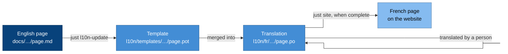

# Translating

We write the documentation in English and translate it through
translation files, never by copying pages. This guide is for translators,
and for anyone who edits a page that has been translated.

## How it works

Each English page is split into strings, meaning its paragraphs,
headings, list items and table cells. The strings go into a **template**,
which is a standard gettext
[PO file](https://www.gnu.org/software/gettext/manual/html_node/PO-Files.html).
Each language then has its own **PO file** for each page, holding a
translation of every string.

When an English string changes, its translation is marked **fuzzy**,
which means someone needs to check it. A page is only published in a
language when every string is translated and none is fuzzy. Until then,
readers see the English page instead, so nobody reads a translation that
has fallen behind.

Code blocks, diagrams and page headers are never offered for translation,
so a translation can't break them. Links become numbered placeholders,
such as `{1}`, which the translation keeps. Decision records and
improvement proposals stay in English, the language they were decided in.

The languages are listed in
[`l10n/languages.toml`](../../l10n/languages.toml), and `just l10n-status`
shows how much of each one is translated.

## Translate a page

1. Open the page's PO file, for example
   `l10n/fr/docs/concepts/emis.po`, in a PO editor such as
   [Poedit](https://poedit.net/) or [Lokalize](https://apps.kde.org/lokalize/),
   or in a translation platform that reads PO files, such as
   [Weblate](https://weblate.org/).
2. Translate every string. Keep each placeholder (`{1}`), each pair of
   `**` and each pair of backticks. Leave values in backticks, such as
   `CAP-ACCESS` or `learners_prod`, exactly as they are.
3. Clear the fuzzy flag on each string once you've checked it.
4. Run `just l10n-update`, then `just check`. The update tidies the files,
   and the check fails if any file is stale or malformed.
5. Preview the site with `nix develop .#site --command just site-serve`,
   and open the page under `/fr/`.

Translated pages carry a note saying that no native speaker has reviewed
them yet. Once a native speaker has reviewed every string in a file, set
the file's `X-Review-Status` header field to `reviewed`, and the note
disappears.

## Translate the website's interface

The menu labels and the review note come from
`site/i18n/<language>.toml`, which uses the same keys as
`site/i18n/en.toml`. The theme translates its own labels, such as "Table
of contents", so you don't need to.

## Edit an English page that has translations

Edit the English page as usual, then run `just l10n-update` in the same
change. The strings you changed become fuzzy in every language, so those
pages show in English until a translator has checked them. Say so in your
change, but don't wait for the translations before making it.

## Add a language

Adding a language is an ordinary reviewed change:

1. Add it to `l10n/languages.toml`, with its
   [BCP 47](https://www.rfc-editor.org/info/bcp47) tag and its name in that
   language. If it's written right to left, add `direction = "rtl"` as
   well.
2. Run `just l10n-update` to create its PO files.
3. Add `site/i18n/<tag>.toml` with the interface strings.

## Writing English that translates well

Translators work one string at a time, so English that's clear on its own
translates best. Keep sentences short, with one idea in each, and choose
plain words over idioms. Write whole sentences rather than fragments, and
don't put text in images. Diagram labels aren't translated yet, so keep
them short.

Use the canonical terms from the [context map](../../CONTEXT-MAP.md),
because a term you use consistently gets translated consistently.
