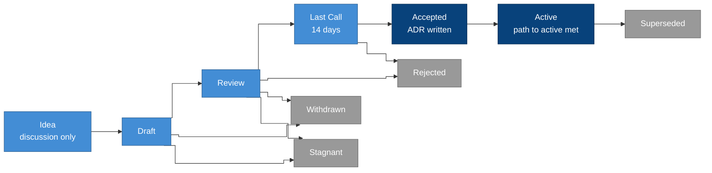

## Summary

A LumenOSS Improvement Proposal (LIP) is how anyone proposes a change to
the blueprint. The change might be a new capability or clause, a change to
the domain model, a new interface, or a change to how the project itself
works. A LIP puts the case for the change, the exact text proposed and its
consequences into one numbered document. That document then moves through
a public lifecycle until it's accepted, rejected or withdrawn. When a LIP
is accepted, the decision is written down as an
[architecture decision record](../adr/README.md), and the change is
released in a catalogue version.

## Motivation

We mean the blueprint to be adopted by education authorities and built by
many teams. Any change to it affects every implementation, so people need
to see how a change happens. They need to know where to propose one, who
decides, how long review lasts, and what an implementation has to do once
the change lands. Open standards bodies worked this out long ago, so LIPs
follow their practice, adapted to a blueprint that governs learners'
data.

## Types

| Type | For | Example |
| --- | --- | --- |
| Standards | A change to the contract: capabilities, clauses, the domain model or the schemas | Add a clause requiring a parity test across serving paths |
| Process | A change to how the project works | This LIP |
| Informational | Guidance, patterns or research that change no requirement | A pattern for reconciling two systems |

A Standards LIP also names its **category**, which says what it changes:

- **Contract** covers capabilities and clauses in the catalogue.
- **Domain** covers the domain model and the domain language.
- **Interface** covers the schemas for bindings, the catalogue, standards
  and LIPs.

## Lifecycle

| Status | Meaning |
| --- | --- |
| Draft | Merged with a number, while the authors are still shaping it |
| Review | The authors are asking for review, and the text should be complete |
| Last Call | The final review window, normally 14 days, ending on the date in `last-call-ends` |
| Accepted | The maintainers have decided to adopt it; its decision record is written |
| Active | Its path to active is complete, so the change is in a released catalogue and in the reference bindings |
| Living | A document that is kept up to date rather than finished, such as this one |
| Stagnant | Nothing has happened for six months while it was in Draft or Review. Any author can revive it. |
| Withdrawn | The authors have stopped pursuing it |
| Rejected | The maintainers decided against it, with the reason recorded in the LIP |
| Superseded | Replaced by a later LIP, named in `superseded-by` |

## Roles

- **Authors** write the LIP, lead the discussion about it and keep it up
  to date. They're named by their code-host handle or by their role.
- **Editors** check that a LIP is complete and well formed, give it a
  number, and move it from one status to the next. Editors judge the form
  of a LIP, not its merit. While the project is small, the maintainers act
  as editors too.
- **Reviewers** are anyone who comments. The steward of every domain a LIP
  touches is asked to review it.
- **Maintainers** are the Data Lead and the Technical Lead. They decide at
  the end of Last Call, on the strength of the arguments rather than by
  counting votes. Either of them may block a decision, and the reason goes
  into the LIP.

## How to propose a change

1. Start with an idea. Open a discussion that describes the problem, not
   just your solution. If the idea has support and nobody has proposed it
   already, carry on.
2. Write a Draft. Copy the [template](template.md) to
   `docs/lips/lip-draft-<short-name>.md` and open a change. The editors
   give it the next free number, rename the file to `lip-NNNN.md`, and
   merge it as a Draft.
3. Ask for review. When the text is complete, the authors move it to
   Review, and comments go to the LIP's discussion.
4. Last Call. When the review has settled, an editor sets Last Call with
   an end date, normally 14 days later, and announces it.
5. Decision. At the end of Last Call, the maintainers accept or reject the
   LIP. If they accept it, they write a decision record that cites the LIP,
   and the LIP records that record's number in `adr`.
6. Path to active. The change is made in the catalogue (or in the process)
   and released in the version named by `catalogue`, and the reference
   bindings give every new clause a status. Then the LIP becomes Active.

Small corrections, such as typos, broken links or wording that doesn't
change the meaning, don't need a LIP. They're ordinary reviewed changes.
[CONTRIBUTING.md](../../CONTRIBUTING.md) lists which changes need a LIP.

### Before 1.0.0

While the catalogue is below 1.0.0, the blueprint is still taking shape,
and few people depend on it yet. So until then, the maintainers may accept
a LIP straight from Draft, without Review or Last Call. The LIP still
records the decision and still gets its decision record, so the history
looks the same. From 1.0.0 onwards, every Standards and Process LIP goes
through Last Call.

## Required sections

Every LIP has these sections, in this order. If a section doesn't apply,
write "None" rather than leaving it out.

| Section | What it says |
| --- | --- |
| Summary | What changes, in a paragraph |
| Motivation | The problem, and why the blueprint as it stands doesn't solve it |
| Specification | The exact change, such as clause text with its level and verification, schema changes, or the process |
| Rationale | The alternatives considered, and why this one |
| Compatibility | The catalogue version change it requires and what each implementation must do |
| Path to active | Acceptance criteria that can be observed, and the plan to meet them |
| Privacy and safeguarding | The effect on learners' and staff members' data, and how harm is prevented |
| Security | New risks and how they are controlled |
| Copyright | The LIP is released under the repository's licence |

## Header

Every LIP starts with YAML front matter, and `just check` validates it
against [`schema/lip.schema.json`](../../schema/lip.schema.json).

| Field | Required | Notes |
| --- | --- | --- |
| `lip` | yes | The number, which must match the file name |
| `title` | yes | At most 80 characters |
| `status` | yes | One of the statuses above |
| `type` | yes | Standards, Process or Informational |
| `category` | Standards | Contract, Domain or Interface |
| `authors` | yes | Handles or roles |
| `created` | yes | Date the Draft was merged |
| `discussion` | no | Link to the discussion |
| `last-call-ends` | Last Call | End date of Last Call |
| `requires`, `replaces` | no | Numbers of related LIPs |
| `superseded-by` | Superseded | Number of the replacing LIP |
| `catalogue` | no | Catalogue version that carries the change |
| `adr` | Accepted, Active | Number of the decision record |

## Relationship to decision records and versions

- A LIP holds the proposal and the discussion about it. A decision record
  is the short, permanent statement of what was decided and why. Every
  accepted LIP has one, and the record cites the LIP.
- A Standards LIP changes the catalogue's version in the way the
  [versioning rules](../adr/0002-capabilities-contracts-and-bindings.md)
  require. Once the catalogue reaches 1.0.0, a new MUST or a changed
  meaning is a major change.
- Implementations follow catalogue versions, not LIPs. A binding says
  which catalogue version it was written against.

## Prior art

LIPs borrow from processes that have governed open standards for decades.
These are the IETF's [Internet Standards Process (RFC 2026)](https://www.rfc-editor.org/info/rfc2026),
Python's [PEP 1](https://peps.python.org/pep-0001/), Bitcoin's
[BIP 3](https://github.com/bitcoin/bips/blob/master/bip-0003.md),
Ethereum's [EIP-1](https://eips.ethereum.org/EIPS/eip-1), which gave us the
Living, Last Call and Stagnant statuses, and Cardano's
[CIP-1](https://cips.cardano.org/cip/CIP-0001), which gave us the path to
active. The privacy and safeguarding section is LumenOSS's own, because
every proposal here touches data about children.

## Copyright

This LIP is released under the Apache License 2.0, like the rest of this
repository.
