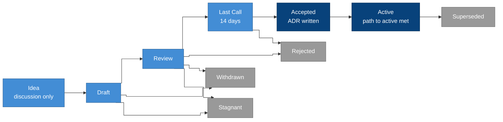

## Summary

A LumenOSS Improvement Proposal (LIP) is how anyone proposes a change to
the blueprint: a new capability or clause, a change to the domain model,
a new interface, or a change to how the project itself works. A LIP
gathers the case for the change, the exact text proposed and its
consequences in one numbered document, which moves through a public
lifecycle until it is accepted, rejected or withdrawn. An accepted LIP is
recorded as an [architecture decision record](../adr/README.md) and
released in a catalogue version.

## Motivation

The blueprint is meant to be adopted by education authorities and built
by many teams. Changes to it affect every implementation, so they need a
visible path: where to propose, who decides, how long review lasts, and
what an implementation must do once a change lands. Open standards bodies
solved this long ago; LIPs follow their practice, adapted to a blueprint
that governs learners' data.

## Types

| Type | For | Example |
| --- | --- | --- |
| Standards | A change to the contract: capabilities, clauses, the domain model or the schemas | Add a clause requiring a parity test across serving paths |
| Process | A change to how the project works | This LIP |
| Informational | Guidance, patterns or research that change no requirement | A pattern for reconciling two systems |

A Standards LIP also names its **category**:

- **Contract:** capabilities and clauses in the catalogue.
- **Domain:** the domain model and the domain language.
- **Interface:** the binding, catalogue, standards and LIP schemas.

## Lifecycle

| Status | Meaning |
| --- | --- |
| Draft | Merged with a number; the authors are still shaping it |
| Review | The authors ask for review; the text should be complete |
| Last Call | The final review window, normally 14 days, ending on the date in `last-call-ends` |
| Accepted | The maintainers have decided to adopt it; its decision record is written |
| Active | Its path to active is complete: the change is in a released catalogue and in the reference bindings |
| Living | A document that is kept up to date rather than finished, such as this one |
| Stagnant | No activity for six months while in Draft or Review; any author can revive it |
| Withdrawn | The authors have stopped pursuing it |
| Rejected | The maintainers decided against it, with the reason recorded in the LIP |
| Superseded | Replaced by a later LIP, named in `superseded-by` |

## Roles

- **Authors** write the LIP, lead its discussion and keep it current. They
  are named by code-host handle or by role.
- **Editors** check that a LIP is complete and well formed, assign its
  number, and move it between statuses. Editors judge form, not merit.
  While the project is small, the maintainers are also the editors.
- **Reviewers** are anyone who comments. The steward of every domain a LIP
  touches is asked to review it.
- **Maintainers** are the Data Lead and the Technical Lead. They decide at
  the end of Last Call, on the strength of the arguments rather than a
  count of votes. Either may block a decision; the reason is recorded in
  the LIP.

## How to propose a change

1. **Start with an idea.** Open a discussion describing the problem, not
   only the solution. If the idea has support and is not a duplicate,
   continue.
2. **Write a Draft.** Copy the [template](template.md) to
   `docs/lips/lip-draft-<short-name>.md` and open a change. The editors
   assign the next free number, rename the file to `lip-NNNN.md`, and merge
   it as Draft.
3. **Ask for review.** When the text is complete, the authors move it to
   Review. Comments go to the LIP's discussion.
4. **Last Call.** When review has settled, an editor sets Last Call with an
   end date, normally 14 days later, and announces it.
5. **Decision.** At the end of Last Call the maintainers accept or reject
   the LIP. On acceptance they write a decision record that cites the LIP,
   and the LIP records its number in `adr`.
6. **Path to active.** The change is made in the catalogue (or the process)
   and released in the version named by `catalogue`; the reference
   bindings give every new clause a status. The LIP then becomes Active.

Small corrections (typos, broken links, wording that changes no meaning)
need no LIP; they are ordinary reviewed changes.
[CONTRIBUTING.md](../../CONTRIBUTING.md) lists which changes need a LIP.

### Before 1.0.0

While the catalogue is below 1.0.0, the blueprint is still taking shape
and few people depend on it. Until then, the maintainers may accept a LIP
directly from Draft, without Review or Last Call. The LIP still records
the decision and has its decision record, so the history is the same.
From 1.0.0, every Standards and Process LIP goes through Last Call.

## Required sections

Every LIP has these sections, in this order; write "None" rather than
leave one out.

| Section | What it says |
| --- | --- |
| Summary | What changes, in a paragraph |
| Motivation | The problem, and why the blueprint as it stands does not solve it |
| Specification | The exact change: clause text with level and verification, schema changes, or the process |
| Rationale | The alternatives considered, and why this one |
| Compatibility | The catalogue version change it requires and what each implementation must do |
| Path to active | Acceptance criteria that can be observed, and the plan to meet them |
| Privacy and safeguarding | The effect on learners' and staff members' data, and how harm is prevented |
| Security | New risks and how they are controlled |
| Copyright | The LIP is released under the repository's licence |

## Header

Every LIP starts with YAML front matter, validated against
[`schema/lip.schema.json`](../../schema/lip.schema.json) by `just check`.

| Field | Required | Notes |
| --- | --- | --- |
| `lip` | yes | The number; must match the file name |
| `title` | yes | At most 80 characters |
| `status` | yes | One of the statuses above |
| `type` | yes | Standards, Process or Informational |
| `category` | Standards | Contract, Domain or Interface |
| `authors` | yes | Handles or roles |
| `created` | yes | Date the Draft was merged |
| `discussion` | no | Link to the discussion |
| `last-call-ends` | Last Call | End date of Last Call |
| `requires`, `replaces` | no | Numbers of related LIPs |
| `superseded-by` | Superseded | Number of the replacing LIP |
| `catalogue` | no | Catalogue version that carries the change |
| `adr` | Accepted, Active | Number of the decision record |

## Relationship to decision records and versions

- A LIP is the proposal and its debate; a decision record is the short,
  permanent statement of what was decided and why. Accepted LIPs always
  have one, and the record cites the LIP.
- A Standards LIP changes the catalogue's version as the
  [versioning rules](../adr/0002-capabilities-contracts-and-bindings.md)
  require: a new MUST or a changed meaning is a major change once the
  catalogue reaches 1.0.0.
- Implementations follow catalogue versions, not LIPs: a binding states
  the catalogue version it was written against.

## Prior art

LIPs borrow from processes that have governed open standards for decades:
the IETF's [Internet Standards Process (RFC 2026)](https://www.rfc-editor.org/info/rfc2026),
Python's [PEP 1](https://peps.python.org/pep-0001/), Bitcoin's
[BIP 3](https://github.com/bitcoin/bips/blob/master/bip-0003.md),
Ethereum's [EIP-1](https://eips.ethereum.org/EIPS/eip-1) (Living status,
Last Call, Stagnant) and Cardano's
[CIP-1](https://cips.cardano.org/cip/CIP-0001) (the path to active). The
privacy and safeguarding section is LumenOSS's own: every proposal here
touches data about children.

## Copyright

Released under the Apache License 2.0, as the rest of this repository.
