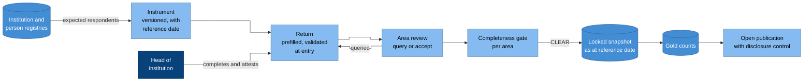

# Example product: annual census

Every institution reports, once a year, a set of counts and facts as at a
single reference date: enrolment by grade and sex, staff and their
qualifications, facilities and services, and the like. The census is the
backbone of an education system's official statistics. As a product it
exercises the registries, periodic collection, data quality, indicators,
disclosure control and open publication.

## Flow

### Why it is drawn this way

- **The registry decides who must respond.** Completeness is measured
  against the institutions that exist, not against the returns that
  arrived ([CAP-COLLECTION.1](../capabilities/cap-collection.md)).
- **The head of the institution attests** the return, so accountability
  for the figures sits where they are known.
- **Review can send a return back.** A query reopens the return with the
  reviewer's reason; every transition is an event
  ([CAP-COLLECTION.3](../capabilities/cap-collection.md)).
- **Nothing is computed until the area is complete,** and then only from a
  locked snapshot ([CAP-COLLECTION.4](../capabilities/cap-collection.md),
  [CAP-COLLECTION.5](../capabilities/cap-collection.md)).

## The instrument

An instrument is a versioned file that declares:

- the reference date and the collection window;
- the expected respondents, as a query over the institution registry;
- each item, with its code list, unit and whether it is required;
- validation rules, each with its quality dimension and severity
  ([CAP-QUALITY.4](../capabilities/cap-quality.md)): blocking rules stop
  submission, warnings need a reason;
- cross-item checks, such as staff counts against postings in the
  registry, or enrolment against the previous year's enrolment in the
  grade below.

A committed instrument never changes; next year's census is a new version.

## The return

- **Prefilled** from the registries and last year's accepted return, so
  respondents confirm and correct rather than retype.
- **Offline-capable:** the form can be completed without a connection and
  synchronised later; submitting twice converges on one return.
- **States:** not started, in progress, submitted, attested, queried,
  accepted, locked.
- **Imputation** for a missing return, if the methodology allows it, is
  flagged on every imputed cell and reported with the figure.

## Outputs

- Gold counts as at the reference date, from which the semantic layer
  derives the participation, teacher and facilities indicators
  ([indicators](../domain/indicators.md)).
- Completeness and timeliness per institution and area, as reported
  measures.
- Open tables with permanent identifiers, after disclosure control
  ([CAP-PUBLICATION](../capabilities/cap-publication.md)).
- A revision after a late correction is a new snapshot version, with the
  reason and both versions readable.

## Running it as a conformance workload

1. Open a census for a fixture registry; the expected respondents equal
   the registry's active institutions as at the reference date.
2. Submit a return with a blocking error; submission is refused with a
   machine-readable error ([CAP-COLLECTION.2](../capabilities/cap-collection.md)).
3. Submit the same return twice from an offline client; one return results.
4. Leave one institution's return missing; its area reads BLOCKED, and the
   other areas release ([CAP-COLLECTION.4](../capabilities/cap-collection.md)).
5. Publish an area with a small cell; the cell and its complement are
   suppressed, and the suppressed value cannot be recomputed from totals
   ([CAP-PUBLICATION.2](../capabilities/cap-publication.md)).
6. Correct an accepted return; a new snapshot version is created, the
   published table gains a new version, and the old one stays retrievable
   ([CAP-PUBLICATION.3](../capabilities/cap-publication.md)).
