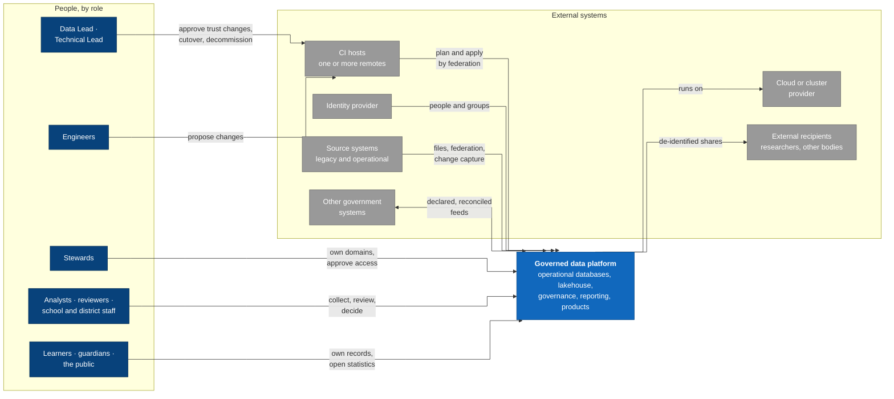
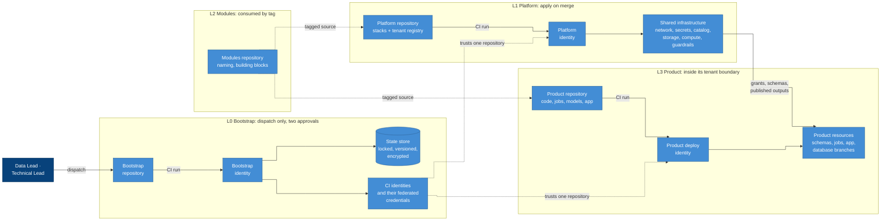
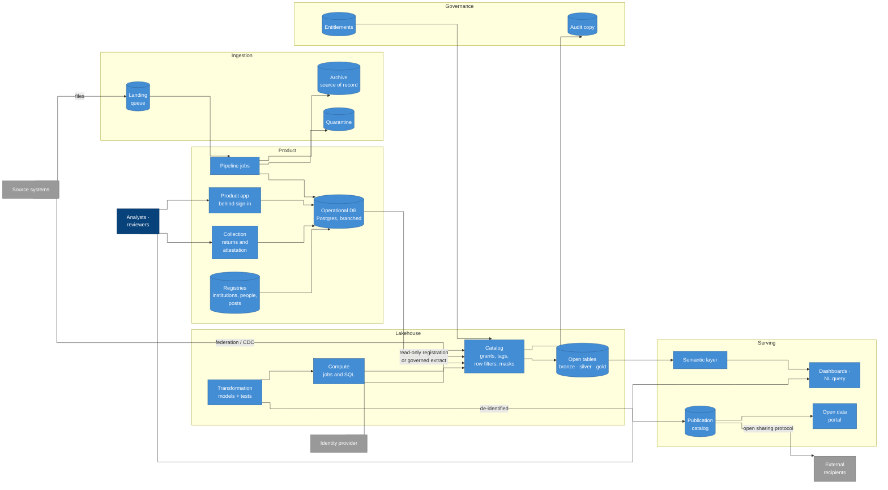
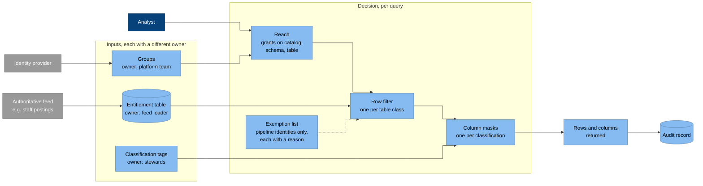
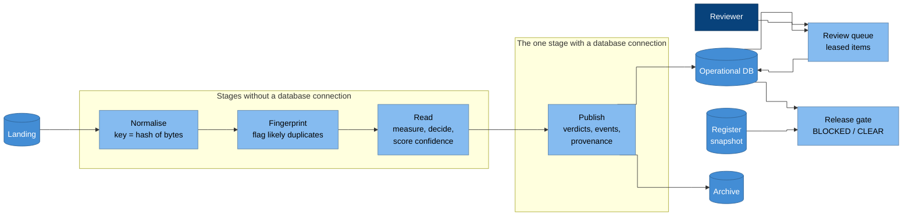

# Architecture

This page draws the architecture at three levels, using the C4 model. C1
shows the system in its context. C2 shows the containers inside it. C3 goes
into the components of the containers where most of the design lives.

Every box is a capability, or a group of capabilities, from the
[catalogue](../capabilities/README.md). You won't see any product names,
because choosing products is up to each implementation
([implementations](../implementations/README.md)).

The colours follow C4 conventions. People are dark blue, the system and its
containers are blue, and external systems are grey.

## C1 System context

### Why it is drawn this way

- Changes reach the platform only through CI. Engineers and leads work on
  the CI host, never on the platform directly
  ([P1](../principles.md#p1-ci-is-the-only-deployer)). So when you see an
  arrow from people to the platform, it means they use it, not that they
  change it.
- There can be more than one CI host. A repository can live on several
  hosts, because the architecture depends on federation, which every
  mainstream host offers, rather than on any one of them
  ([CAP-REPOSITORIES.5](../capabilities/cap-repositories.md)).
- Recipients sit outside the boundary, because data only leaves as a
  de-identified publication ([P15](../principles.md#p15-publish-never-export)).
- The identity provider belongs to the organisation, not to the platform
  ([CAP-IDENTITY.1](../capabilities/cap-identity.md)). Learners, guardians
  and the public sign in separately, and they never join platform groups
  ([CAP-IDENTITY.6](../capabilities/cap-identity.md)).
- Exchanges with other government systems run in both directions, and each
  one is declared and reconciled
  ([CAP-INTEROPERABILITY](../capabilities/cap-interoperability.md)).

## C2 Containers: trust and delivery

Each row here is a layer, and each layer is a repository. An arrow from a
repository to an identity is a CI run. The run exchanges the token the CI
host gives it for that identity, which is what federation means. Notice
that no arrow starts on a workstation.

### Why it is drawn this way

- The rows are levels of trust, and each row is a repository
  ([P2](../principles.md#p2-repositories-are-split-by-trust-state-is-split-by-blast-radius)).
  One row's identity can't act in another row, because its federated
  credential trusts only one repository.
- Only the bootstrap row is started by people. It declares who CI is, so a
  merge on its own must never change it
  ([P4](../principles.md#p4-the-root-of-trust-is-made-once-by-a-person-and-cannot-widen-itself)).
- The platform reaches products only through what it generates from the
  tenant registry, meaning grants, schemas and published outputs. The
  product never reads the platform's state
  ([CAP-ONBOARDING.3](../capabilities/cap-onboarding.md)).
- The lines for modules and for trust are dashed because neither is a call
  at run time. Modules are source code, and credentials are declarations.

## C2 Containers: the data platform

### Why it is drawn this way

- The catalog sits in the middle because every read and write of
  analytical data goes through it. That's why one set of policies is
  enough ([CAP-CATALOG](../capabilities/cap-catalog.md),
  [CAP-COMPUTE.3](../capabilities/cap-compute.md)).
- Landing feeds the pipeline, and the pipeline feeds the archive and
  quarantine, because landing is a queue rather than a place to keep things
  ([CAP-INGESTION.2](../capabilities/cap-ingestion.md)).
- The product app talks only to its own operational database. Analytics
  reach that database through the catalog, never over a direct connection
  ([CAP-OPERATIONALDB.7](../capabilities/cap-operationaldb.md)).
- Dashboards read the semantic layer rather than tables, so each measure
  has one definition
  ([P11](../principles.md#p11-reporting-goes-through-a-governed-transformation-layer)).
  The [semantic layer](semantic-layer.md) page shows how that one
  definition reaches every consumer.
- Publication is a separate store, and only models write to it, so nothing
  reaches a recipient without going through de-identification
  ([CAP-SHARING.1](../capabilities/cap-sharing.md)). Open statistics leave
  through the portal after disclosure control
  ([CAP-PUBLICATION](../capabilities/cap-publication.md)).
- Registries and collection sit with the products because they're
  operational. They hold the authoritative records and returns that
  everything downstream counts
  ([CAP-MASTERDATA](../capabilities/cap-masterdata.md),
  [CAP-COLLECTION](../capabilities/cap-collection.md)).

## C3 Components: access decision

This is how the catalog decides what a single query returns.

### Why it is drawn this way

- There are three inputs, and each has a different owner
  ([P14](../principles.md#p14-access-is-role--scope--sensitivity)). The
  platform team owns the groups, a loader owns the entitlements, and
  stewards own the classification. So no single change can widen all three
  ([CAP-ACCESS.6](../capabilities/cap-access.md)).
- The decision is a chain, and each step can only narrow it. Reach lets
  you at the table, and then the row filter and masks can only take things
  away ([CAP-ACCESS.3](../capabilities/cap-access.md)).
- The exemption list is dashed and kept short, because every entry on it
  is a path to raw data ([CAP-ACCESS.4](../capabilities/cap-access.md)).

## C3 Components: product pipeline

This is how the example product processes a file, from the moment it
arrives to the released result. The
[document-review product](../../guides/products/document-review.md) page
describes it in full.

### Why it is drawn this way

- The stages are separate jobs joined by storage. So a stage can't get
  ahead of the one before it, and you can retry each one on its own
  ([CAP-PIPELINE.3](../capabilities/cap-pipeline.md)).
- Only the publish stage touches the database. The three stages before it
  keep working even when the database is unavailable
  ([CAP-PIPELINE.6](../capabilities/cap-pipeline.md)).
- Review sits beside the pipeline rather than inside it. People decide at
  their own pace, and their decisions outrank any re-run
  ([CAP-REVIEW.3](../capabilities/cap-review.md)).
- The gate reads both the database and the register snapshot, because
  before anything is released it needs to know which subjects were
  expected, as well as the results
  ([CAP-RELEASE.1](../capabilities/cap-release.md)).
