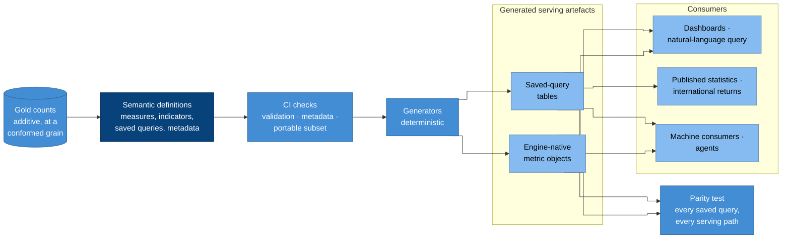

# The semantic layer

The semantic layer is where every measure and indicator is defined, once,
in version control. Dashboards, natural-language query, agents, published
statistics and international returns all read from it. So an enrolment
ratio means the same thing on every screen, in every file and in every
release ([P11](../principles.md#p11-reporting-goes-through-a-governed-transformation-layer),
[CAP-SEMANTICS](../capabilities/cap-semantics.md)).

This matters more for an EMIS than for most platforms. People compare
official indicators across years, areas and countries. If a definition
drifts between two tools, you end up with two "official" figures, and only
one of them can be right.

## How it works



### Why it is drawn this way

- The definitions sit on top of the counts in gold. Gold stores counts
  that can be added up, and the semantic layer computes every ratio from
  them, so you get the right answer at any level of aggregation
  ([CAP-TRANSFORMATION.5](../capabilities/cap-transformation.md)).
- Everything a consumer reads is generated. CI produces the
  engine-native metric objects and the saved-query tables from the
  definitions, and nobody writes them by hand
  ([CAP-SEMANTICS.8](../capabilities/cap-semantics.md)).
- A parity test closes the loop. Every serving path must return the same
  numbers for every saved query, and that's what "defined once" means in
  practice ([CAP-SEMANTICS.9](../capabilities/cap-semantics.md)).
- Published statistics come from saved-query tables, stamped with the
  definition's version and the reference date, never from a live query.

## Rules that keep one definition portable

1. Model each indicator as a ratio of counts that add up, on one gold
   table. The numerator and the denominator are counts at the same grain,
   meaning the same reference date, area, sex, age, level and so on. If
   the denominator comes from outside, such as a population estimate, join
   it into gold along with its version. That way every engine computes the
   ratio the same way.
2. Stick to a portable subset of metric types. That means simple counts
   and sums, ratios, and derived expressions without time offsets.
   Anything else, such as cumulative windows, offsets or conversion
   funnels, needs a recorded and tested mapping for each serving engine
   ([CAP-SEMANTICS.7](../capabilities/cap-semantics.md)).
3. Keep each indicator's metadata with its definition, and check it in
   CI. The metadata gives the code, the edition of the international
   definition it follows, the unit, the reference-date rule, the
   disaggregations allowed, the coverage rule, the owner and the version
   ([CAP-SEMANTICS.3](../capabilities/cap-semantics.md)).
4. Version the definitions together with the models that produce their
   counts, in the same project and in the same review
   ([CAP-SEMANTICS.6](../capabilities/cap-semantics.md)).

## In the reference implementations

Both reference implementations use the **dbt semantic layer**
([ADR-0011](../../adr/0011-dbt-semantic-layer.md)). You write semantic
models and metrics in dbt's YAML specification (the latest one, for dbt
1.12 and later), and **MetricFlow**, which is licensed under Apache-2.0,
validates and compiles them.

| | Open source | Databricks |
| --- | --- | --- |
| Definitions | dbt semantic YAML in the transformation project | The same |
| Engine | MetricFlow over Trino, through dbt-trino | MetricFlow over Databricks SQL, through dbt-databricks |
| Engine-native objects | — | Unity Catalog metric views, generated as dbt models with the `metric_view` materialisation |
| Saved-query tables | dbt models generated from MetricFlow's compiled SQL | The same |
| Dashboards | Superset reads the saved-query tables; Superset's semantic-layer support is tracked | AI/BI dashboards and Genie read the metric views |
| Machine consumers | A thin service over MetricFlow and Trino | Genie and SQL over metric views |

dbt's hosted platform adds live semantic APIs, scheduled exports, caching
and ready-made BI integrations, but neither implementation depends on it.
Questions we know in advance are answered from generated tables, and ad-hoc
questions go through the engine-native objects or a service built on
MetricFlow. We're also tracking
[Apache Ossie](../standards.md#open-data-and-exchange), an open format for
exchanging semantic definitions. Once dbt and the engines that consume the
definitions support the same released version of it, it can replace the
generators.

### An indicator, as defined

Here's an illustration of how the gross enrolment ratio
([indicators](../domain/indicators.md#worked-example-gross-enrolment-ratio))
looks in dbt's latest YAML specification. The field names follow the dbt
documentation as it stood in October 2026, so check the current
specification before you copy it.

```yaml
models:
  - name: gold_enrolment_by_level
    description: >-
      Enrolled learners and official-age population, as at each census
      reference date, by area, sex and ISCED level.
    semantic_model:
      enabled: true
      agg_time_dimension: reference_date
    columns:
      - name: enrolment_level_key
        entity:
          type: primary
          name: enrolment_level
      - name: reference_date
        dimension:
          type: time
        granularity: day
      - name: area_code
        dimension:
          type: categorical
      - name: sex
        dimension:
          type: categorical
      - name: isced_level
        dimension:
          type: categorical
    metrics:
      - name: enrolled_learners
        type: simple
        agg: sum
        expr: enrolled_count
      - name: official_age_population
        type: simple
        agg: sum
        expr: official_age_population

metrics:
  - name: gross_enrolment_ratio
    label: Gross enrolment ratio
    description: >-
      Total enrolment in a level, regardless of age, as a share of the
      population of official school age for that level.
    type: ratio
    numerator: enrolled_learners
    denominator: official_age_population
    config:
      meta:
        indicator_code: GER
        definition: UIS Glossary, Education Metadata (2026)
        unit: ratio
        reference_date_rule: census reference date
        disaggregations: [area_code, sex, isced_level]
        denominator_source: population estimate, versioned in reference data
        owner: statistics steward
        version: 1
```
