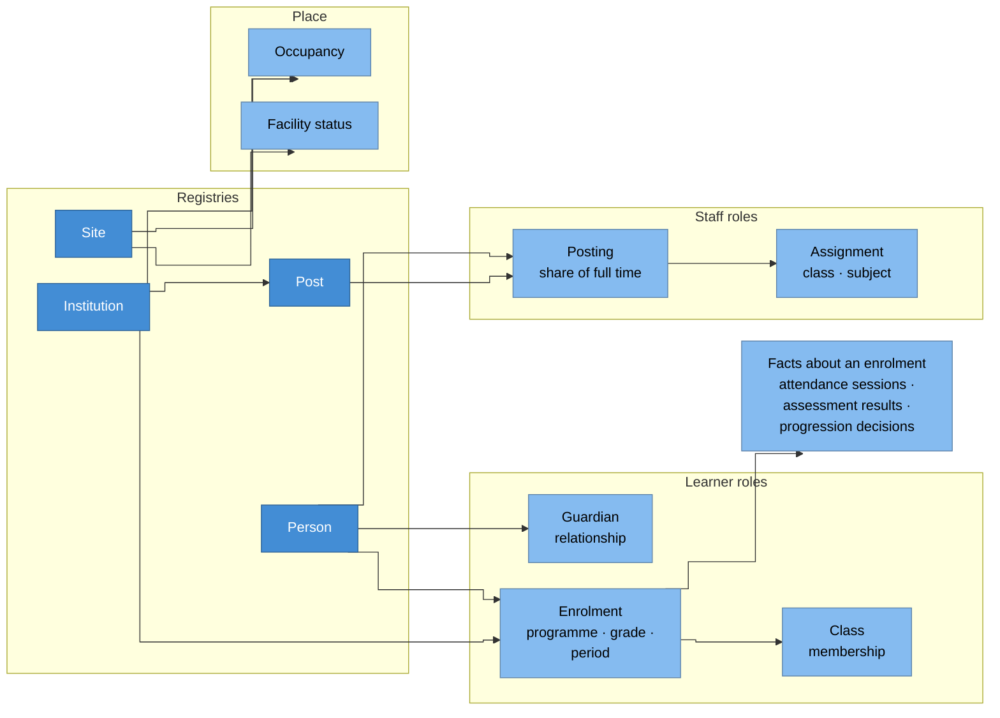

# The EMIS domain model

This page describes the data an education management information system
holds, how that data is divided into domains, and the rules every
implementation follows when it models them. The capabilities describe the
platform; this page describes the data the platform exists for.

Code lists and local terms vary from country to country, but the resources
and rules below don't. Every term on this page is defined in the
vocabulary of its bounded context, and you'll find the contexts listed in
the [context map](../../../CONTEXT-MAP.md). How the contexts themselves are
designed is covered in [domain design](design.md).

## Domains

Each domain is a catalog in each environment, named `<domain>_<env>`
([CAP-CATALOG.2](../capabilities/cap-catalog.md)), and each has one
steward who owns it. A resource lives in exactly one domain. Other domains
refer to it, but they never copy it. Each domain also belongs to one
bounded context, although a context may own several domains
([domain design](design.md#contexts-and-catalogs)).

| Domain | Core resources | Typical sensitivity |
| --- | --- | --- |
| `people` | Person registry, external identifiers | T3 |
| `institutions` | Institution and site registries, occupancy, facility status, licence and accreditation, inspection | T1, with T0 aggregates |
| `learners` | Enrolment, class membership, guardian relationship, attendance session, progression decision, completion and credential, support plan | T3; support and child-protection records T4 |
| `workforce` | Post registry, posting, assignment, qualification, licence or registration, leave, professional development, separation | T3; special-category data T4 |
| `assessment` | Assessment instrument, administration, candidate, result, accommodation | T3, with T0 aggregates |
| `curriculum` | Programme, grade, subject, class, academic period, timetable | T1 |
| `finance` | Budget, income, expenditure by function, fee and payment, grant and aid | T1; individual payments T3 |
| `resources` | Asset, inventory, issue of an item to a person, distribution from the centre | T1 |
| `entitlements` | Entitlement schemes and their beneficiaries | T3 |
| `safety` | Incident, risk assessment, emergency plan | T3; health T4 |
| `statistics` | Collections, instruments, returns, attestations, snapshots | T1; returns naming individuals T3 |
| `records` | Record classes, disposals, correction requests, disclosures, purposes | T3 |
| `reference` | Code lists, crosswalks, administrative geography, calendars, external denominators | T0 |
| `publication` | De-identified and aggregate outputs only | T0 or T2 |

The registries of [CAP-MASTERDATA](../capabilities/cap-masterdata.md) are
split by what they identify. Persons are in `people`, institutions and
sites are in `institutions`, and posts are in `workforce`. There's no
separate registry of learners, staff members or guardians, because those
are roles a person holds through relationships
([ADR-0010](../../adr/0010-one-person-registry.md)). The `reference` domain
holds the code lists and the data dictionary of
[CAP-REFERENCE](../capabilities/cap-reference.md).

## Core resources and relationships

Every relationship and fact also belongs to an academic period and uses
governed code lists. We've left those links out of the drawing to keep it
readable.

### Why it is drawn this way

- **One person, many roles.** A person is recorded once, whether they're a
  learner, a guardian or a staff member, and over a lifetime they may be
  all three. The roles are relationships, not separate registries
  ([ADR-0010](../../adr/0010-one-person-registry.md)).
- **Institutions occupy sites.** Two institutions can share one site on
  different shifts, and one institution can work from several sites. So
  the link between them is a relationship with dates. Facilities belong to
  the site, and you read an institution's services through its
  occupancy.
- **Enrolment and class membership are separate.** A learner is enrolled in
  one programme and grade, but they may be taught in a class that spans
  grades, or take one subject with a higher grade.
- **A post is not a person.** Shortages and vacancies are the difference
  between the posts and the people posted to them. A posting records its
  share of full time, so a teacher who works at two institutions is
  counted correctly, whether you count heads or full-time equivalents.
- **Facts belong to relationships.** That way an attendance session or a
  result can always be traced to an enrolment in a specific period.

## Modelling rules

1. **Identifiers mean nothing and never change.** An identifier carries
   no information about the person or thing it identifies, and a learner
   keeps the same one for life
   ([CAP-MASTERDATA](../capabilities/cap-masterdata.md)).
2. **Every relationship that changes is effective-dated.** It records when
   it was valid from, when it was valid to, and when it was recorded. A
   correction adds a new version, so history is never edited
   ([P18](../principles.md#p18-append-only-records-expand-then-contract-change)).
3. **Store events and counts, and derive every rate.** Attendance rates,
   ratios and percentages are computed from counts in the semantic layer.
   They're never stored on records, because you can't re-aggregate a
   stored rate to a different level
   ([CAP-TRANSFORMATION.5](../capabilities/cap-transformation.md)).
4. **An attribute with several values becomes rows.** A list of languages
   or subjects is a child table that refers to a code list, not a
   delimited string or an embedded document. Bronze may hold the data as
   it was received, and silver normalises it.
5. **Every coded attribute names its code list and its version**
   ([CAP-REFERENCE.1](../capabilities/cap-reference.md)).
6. **Status and reason are kept apart.** An enrolment has a state (active,
   suspended or ended) and, once it ends, an exit reason (completed,
   transferred, left the education system or deceased). If you mix the
   two, you can no longer tell a transfer from a dropout.
7. **Repetition and promotion are derived.** They follow from the
   progression decision and the next period's enrolment, never from a
   stored flag. So when either is corrected, the correction shows up
   everywhere.
8. **Formats are fixed once,** in the data dictionary, and never system by
   system ([CAP-REFERENCE.6](../capabilities/cap-reference.md)).
9. **Documents are records.** A certificate, plan or medical note attached
   to a record is stored by its content hash, classified at least as high
   as the record, and kept for as long as the record's retention class
   says ([CAP-RECORDS](../capabilities/cap-records.md)).

## Default classification

This table is the starting point for
[CAP-CLASSIFICATION.6](../capabilities/cap-classification.md). An
implementation may classify an attribute higher, but classifying it lower
needs a recorded reason.

| Kind of attribute | Default |
| --- | --- |
| Published aggregates | T0 |
| Institution facts (type, location, facilities, programmes) | T1 |
| Pseudonymised learner-level analytical tables | T2 |
| Data that identifies or locates a person: names, birth dates, contact details, addresses, photographs, identifiers | T3 |
| Special-category data under the applicable data-protection law, and child-protection and wellbeing records | T4 |

## Building order

You can build a resource once everything it refers to exists. So
reference data and the registries come first, and derived outputs come
last. The [building guide](../../guides/building.md) generates the order of
capabilities from their dependencies.

How indicators are defined and computed is described in
[indicators](indicators.md).
