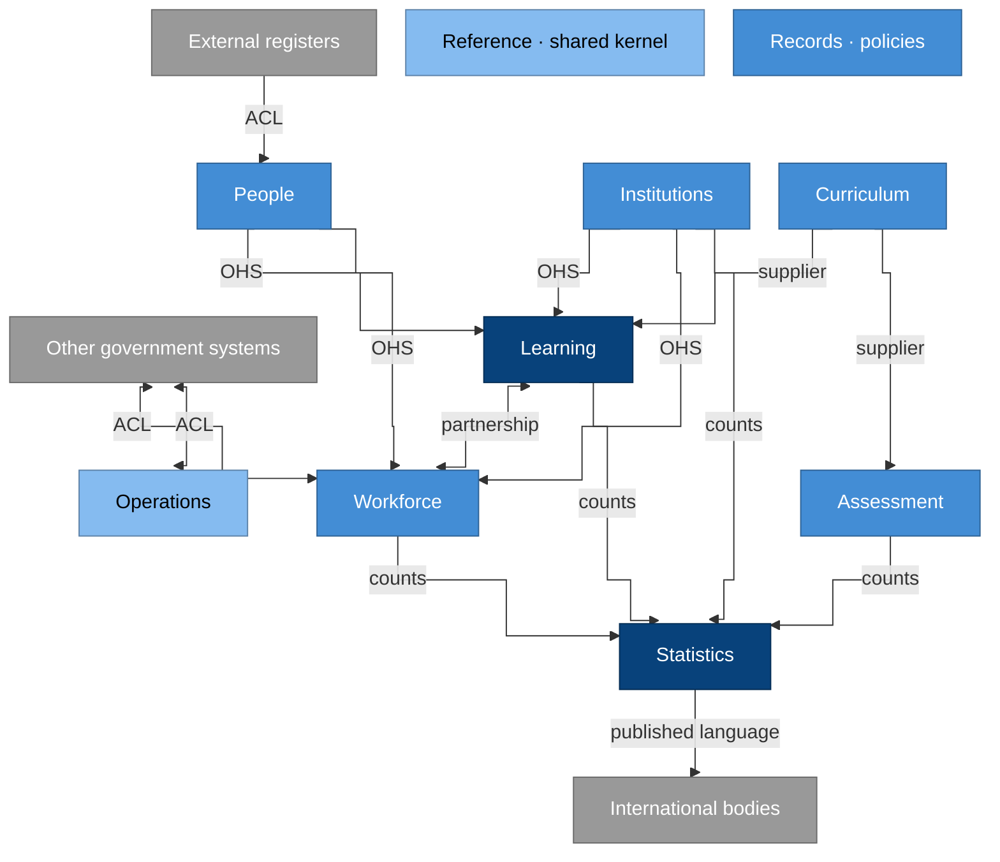

# Domain design

This page describes how the EMIS domain is designed, using domain-driven
design. It says which parts matter most, where the boundary between one
model and the next lies, what each model guarantees, and how the parts
talk to each other.

Each context's vocabulary is in its own `CONTEXT.md`, and the
[context map](../../../CONTEXT-MAP.md) lists them all. The resources and
modelling rules are in the [domain model](README.md).

## Subdomains

| Kind | Contexts | Why |
| --- | --- | --- |
| Core | Learning, Statistics | They're what an education authority uses an EMIS for: knowing who is learning where, and producing official figures about it. They're built and modelled with the most care. |
| Supporting | People, Institutions, Workforce, Curriculum, Assessment, Records | The core needs them, and they're specific to education, but each follows a well-understood pattern, such as a registry, an establishment or a classification. |
| Generic | Operations, Reference | Finance, assets, entitlement schemes, safety, codes and calendars are often provided by existing systems or standards, so they're integrated rather than invented. |

## Context map

### Why it is drawn this way

- **The core contexts are the darkest.** Learning and Statistics carry the
  decisions the authority has to answer for, and everything else serves
  them.
- **People and Institutions serve the others as open host services.** They
  publish identifiers and a stable interface, so every context refers to
  the same person and the same institution without copying them.
- **External systems sit behind anti-corruption layers.** That way a civil
  register's model, or a finance system's, never becomes the EMIS's model.
- **Statistics reads only published counts.** This keeps official figures
  independent of how each context stores its operational records
  ([CAP-INTEROPERABILITY.8](../capabilities/cap-interoperability.md)).
- **Reference and Records have no edges.** They shape every context,
  through shared codes and a shared retention policy, so drawing all their
  edges would hide everything else. The
  [context map](../../../CONTEXT-MAP.md) lists those relationships.

In the drawing, ACL stands for an anti-corruption layer and OHS for an
open host service, and "counts" are the gold tables each context
publishes.

## Aggregates and invariants

An **aggregate** is a cluster of records that change together as one
unit, with a root record that every change goes through. The rules below,
called invariants, hold after every change. If a change would break one,
it's refused.

| Context | Aggregate (root) | Invariants |
| --- | --- | --- |
| People | Person | One person per human: a suspected duplicate goes to review, never auto-merged. The identifier never changes or is reused; a merge leaves a redirect from the retired identifier. External identifiers are attributes, each with an issuer and validity. |
| Institutions | Institution | An active institution occupies at least one site. Closing it ends every occupancy on the closure date. A merger is an effective-dated event on both institutions; neither history is lost. |
| Institutions | Site | Facility status is recorded as at a date; a new status supersedes, never overwrites, the previous one. |
| Learning | Enrolment | It refers to one person, institution, programme, grade and academic period. A learner has at most one main enrolment at any moment; others are secondary. An ended enrolment has an exit reason; an active one has none. |
| Learning | Guardian relationship | It refers to a learner and a guardian (a person or an organisation) with legal authority, from a start date to an end date. Access through it ends when the authority ends. |
| Learning | Attendance session | It belongs to an enrolment, and its date lies inside the enrolment's validity. |
| Learning | Progression decision | At most one per enrolment per academic period; a revision is a new version that keeps the previous one. |
| Workforce | Post | A post belongs to one institution. The shares of full time of the postings to it at any moment add up to at most one. |
| Workforce | Posting | It refers to a person and a post. A person's postings at any moment add up to at most their contracted share of full time. |
| Curriculum | Programme | It maps to exactly one level in the current education-level crosswalk. Its grades are ordered without gaps. |
| Assessment | Administration | Its instrument version is fixed. A released result is never edited; a correction is a new version. |
| Statistics | Instrument | Once committed it never changes; next period's collection is a new version. |
| Statistics | Return | It moves only through its declared states. Only an attested return can be accepted, and a locked return never changes. |
| Statistics | Snapshot | It is locked as at its reference date. A revision is a new snapshot version, with the reason, and both remain readable. |
| Records | Disclosure | It records who received what, why, on what basis and how; it is never deleted before its own retention ends. |
| Records | Correction request | It produces a new version of the corrected record, approved by the steward; the original value stays readable. |

A rule that spans two aggregates isn't enforced by changing both at once.
Instead, the second change follows the first through an event, so the two
become consistent shortly afterwards. A transfer, for example, ends one
enrolment and starts another, and the event between them links the two
changes.

## Domain events

Events are named in the past tense, in the context's own vocabulary, and
published as CloudEvents
([CAP-INTEROPERABILITY.9](../capabilities/cap-interoperability.md)). Other
contexts react to these events, rather than reading each other's records.

| Context | Events |
| --- | --- |
| People | PersonRegistered, PersonVerified, PersonsMerged, PersonsUnmerged, PersonDeceasedRecorded |
| Institutions | InstitutionRegistered, InstitutionsMerged, InstitutionClosed, OccupancyStarted, OccupancyEnded, FacilityStatusRecorded |
| Learning | LearnerEnrolled, EnrolmentEnded, ClassMembershipChanged, AttendanceRecorded, ProgressionDecided, GuardianAuthorityStarted, GuardianAuthorityEnded |
| Workforce | PostEstablished, PostAbolished, PostingStarted, PostingEnded |
| Assessment | ResultRecorded, ResultsReleased |
| Statistics | InstrumentCommitted, ReturnSubmitted, ReturnAttested, ReturnQueried, ReturnAccepted, AreaCleared, SnapshotLocked, SnapshotRevised, DatasetPublished |
| Records | RecordArchived, RecordClassDisposed, DisclosureMade, CorrectionApplied |
| Reference | CodeListVersionPublished, BoundaryVersionPublished |

For example, when **EnrolmentEnded** carries the exit reason
"transferred", Statistics counts the learner at the receiving institution
from the next **LearnerEnrolled**, and Records starts the retention clock
of the ended enrolment.

## Contexts and catalogs

| Context | Catalogs it owns |
| --- | --- |
| Reference | `reference` |
| People | `people` |
| Institutions | `institutions` |
| Learning | `learners` |
| Workforce | `workforce` |
| Curriculum | `curriculum` |
| Assessment | `assessment` |
| Statistics | `statistics`, `publication` |
| Records | `records` |
| Operations | `finance`, `resources`, `entitlements`, `safety` |

## How contexts map onto the platform

- **Each context has one steward.** A context owns the catalogs of its
  resources, listed in the table above, and one role is its steward.
- **A product sits inside one context.** Its repository, operational
  database and tenant entry all belong to that context. If a product
  needs another context's data, it uses that context's published
  interfaces.
- **Contexts connect only through published interfaces.** Those are
  registry interfaces, domain events, and gold tables with their
  semantic-layer definitions. No product reads another context's
  operational database
  ([CAP-INTEROPERABILITY.8](../capabilities/cap-interoperability.md)).
- **The vocabulary follows the boundary.** A term means what its context's
  `CONTEXT.md` says it means. Where two contexts use the same word
  differently, each defines it for itself, and the translation happens at
  the interface between them.
